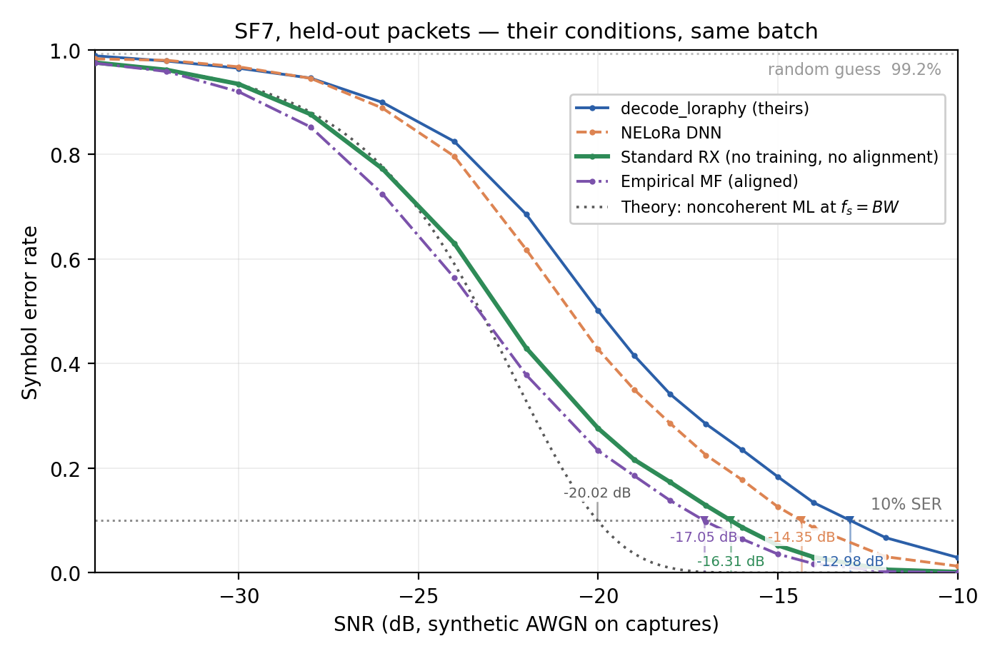
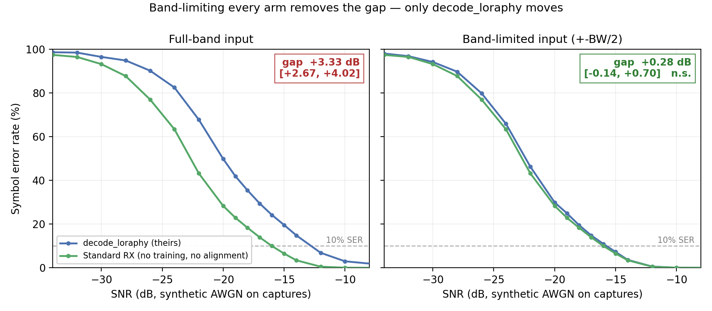
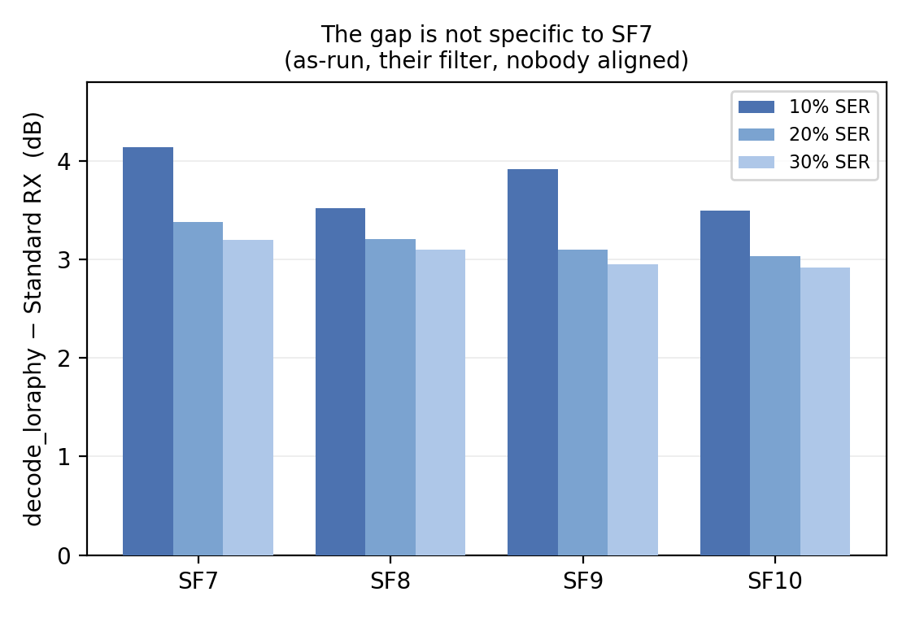

# NELoRa 재검증 — 빠진 것은 대역제한이다

> ***NELoRa 의 기준 복조기는 de-chirp 앞의 대역제한을 건너뛴다. 그들이 자기 baseline 의
> 출처라고 밝힌 원본 LoRaPHY 구현에는 그 두 줄이 있다 — 즉 기준점의 불완전한 이식본이다.***
>
> **데시메이션이 아니라 대역제한이다.** 표본률을 내리는 것 자체는 손해다 — 대역제한 없이
> 4:1 로 솎으면 1 MHz 에 퍼져 있던 잡음이 250 kHz 로 접혀 **6.02 dB 를 잃는다**(본편 §3.3).
> 실제 수신기도 오버샘플링을 하고, **채널 필터를 거친 뒤에** 데시메이션한다. 그 순서가
> 핵심이고, 포팅본에 없는 것이 그 필터다.
>
> SF7 / BW125k, 10% SER, **그들 조건 · 같은 배치 · 패킷 분리 held-out**(§5-4):
> `decode_loraphy` −12.98 dB → 그들 신경망 −14.35 dB(**+1.36**, macro +1.45) →
> 학습도 정렬도 없는 표준 수신기 **−16.31 dB(+3.32)**.
> 상한인 D3(정렬된 경험적 MF)는 −17.05 dB 다.
>
> **표준 수신기가 신경망을 +1.60 ~ +2.05 dB 앞선다** — 체크포인트(최종/검증 최고)와
> 모드(train/eval)를 **어떻게 고르든** 그렇다(§5-11 표). 그 중 **그들 조건 그대로**인 값이
> **+1.96 dB** [95% CI +1.31, +2.59] 이고(최종 체크포인트 · train 모드 — 그들 `test()` 가
> `.eval()` 을 부르지 않는다, §5-5), 같은 비교를 macro 축으로 재면 +2.05 dB 다.
> 범위의 **최솟값 +1.60 은 eval 모드 · 검증 최고 에포크**, 곧 DNN 에 가장 유리한 조합이다.
>
> 그 신경망은 그들 코드(시드·패킷분할 패치판)로 150에포크 이어 학습한 것이고, held-out
> macro 이득 **+1.45 dB** 로 그들이 발표한 SF7 수치(+1.46 dB) **수준에 도달한다**
> (정확한 대응은 아니다 — §5-3). 전량 평가 · 별도 체크포인트에서는 +1.50 dB 다(§5-6).
> 하네스는 그들 `test()` 를 무수정으로 돌린 값과 네 지점 모두 **0.1 dB 이내**로 일치한다.
>
> §5·§7 의 숫자(+3.4~+4.1 dB)는 **다른 모집단**(payload 만, 패킷 분리)에서 잰 보조
> 결과다. 헤드라인과 섞어 읽지 말 것 — §5 머리말 참조.
>
> 측정 2026-09-21 ~ 09-23 · 대상 [10] NELoRa (SenSys'21) / NELoRa-Bench (ICLR'23 workshop)
>
> ⚠️ **3차 개정판 · 6차 검토 반영.** 정정 **열일곱 건**(그중 셋은 결론 철회, 한 건은
> 측정이 아니라 절차 결함 §9-16) +
> 문서 표기·논리 **열한 건**(§9-11, 측정값 변화 없음).
> 무엇이 어떻게 틀렸는지는 **§9** 에 전부 적혀 있다 — 남은 숫자를 믿을 근거가 그것이다.
>
> ⚠️ **SNR 축의 규약 — 전대역(fs = 1 MHz)이다.** 그들 `add_noise` 는 잡음 진폭을
> `amp = 10^(-snr/20)·mean|y|` 로 정하고 샘플마다 더하므로, 표기 SNR 의 기준 잡음대역이
> 신호대역 BW = 125 kHz 가 아니라 **샘플률 1 MHz** 다. 같은 상황을 in-band 로 적으면
> **9.03 dB 높다.** 이 보고서는 그들 축을 그대로 쓰므로 모든 dB 는 전대역 기준이다.
> 환산과 이론 교차점은 **§2-1** 에 있다.
>
> ⚠️ SNR 축은 **합성 AWGN** 이다. 캡처가 이미 잡음을 포함하므로 실제 SNR 은 표기값보다
> 약간 낮다. 절대 dB 가 아니라 **격차**를 읽어야 한다. 그 "약간" 을 §2-1 에서 쟀다 —
> 최상 팔은 규약을 되돌리면 이론과 **0.11 dB** 안이고, 벌어져 보이던 2.97 dB 중
> **2.89 dB 는 잡음 규약**이었다. **격차는 네 규약에서 전부 CI 가 겹친다.**

---

## 0. 요약

| 주장 | 결과 |
|---|---|
| **NELoRa 의 기준 복조기는 de-chirp 앞의 대역제한을 건너뛴다** | **확정.** SF7 에서 +3.32 dB (held-out, §5-4). **SF7~10 에서 +3.50~+4.14** (as-run, §7 — U=10 기준, U=100 이면 ~0.25 dB 낮다) |
| **그 baseline 은 원본 LoRaPHY 의 완전한 이식인가** | **아니다.** 그들 README 가 출처로 밝힌 LoRaPHY(Xia et al. TOSN'22)에는 de-chirp 앞에 `lowpass(bw/2)` → `resample(2·BW)` 두 줄이 있고 포팅본에 **없다**. 되살리면 **+3.02 dB [+2.49, +3.65]** 가 돌아오고, 남은 차이는 표준 RX 와 구별되지 않는다 (§5-12) |
| 그 손실의 내역 | **대역제한 생략 3.29 dB + 제로패딩 U=100 0.60 dB** (§5-1) |
| 그 격차가 정말 대역 밖 잡음인가 | **대부분 설명된다.** 모두에게 대역제한 입력을 주면 **+3.33 → +0.28 dB [−0.14, +0.70]**. 0 과 구별되지 않지만 **잔차 ≤0.7 dB 와도 양립**한다 (§5-10) |
| 대역제한 + DNN 이 대역제한 단독을 넘는가 | **못 넘는다.** 대역제한 입력 DNN 은 표준 RX 에 0.82 dB **[+0.28, +1.44]**, 자기 baseline 에 0.53 dB **[+0.10, +1.05]** 못 미친다 — **둘 다 유의** (§5-11) |
| **같은 배치에서 DNN 과 비교** | **확정.** 표준 RX − DNN = **+1.60 ~ +2.05 dB**(체크포인트·모드 전부), 그들 조건에서 **+1.96** [+1.31, +2.59], 패킷 분리 held-out (§5-4) |
| 그 DNN 이 제대로 학습된 것인가 | **재학습함.** held-out 에서 +1.36 dB (macro **+1.45**) = 그들 발표 +1.46 수준 (§5-4). 전량 평가·다른 체크포인트로는 +1.50 (§5-6) |
| held-out 으로 쟀는가 | **쟀다.** 패킷 단위 9:1 분할(18패킷/1353심볼), 시드 고정, 인덱스 저장 |
| 그 하네스가 믿을 만한가 | **검증됨.** 그들 `test()` 무수정 실행과 네 지점 0.1 dB 이내 (§5-4) |
| fs = BW 의 de-chirp+FFT = 최적 검출 | **확인.** 이상 신호에서 정합필터와 0.25 dB, 실캡처 +0.04~+0.13 dB (§6). 즉 "표준 RX" 는 더 좋은 검출기가 아니라 **표준 복조기를 맞는 표본률에서 돌린 것**이다 |
| 그들 평가 baseline 이 대역제한을 하는가 | **안 한다.** `decode_loraphy` 원문 확인 (§1). 대역제한 **없이** 솎으면 더 나빠진다 — 순서가 전부다 (§6) |
| **SNR 축이 어느 규약인가** | **전대역(fs = 1 MHz)이다.** in-band 보다 9.03 dB 낮게 표기된다. 이 축에서 SF7 10% SER 의 이론 교차점은 **−20.02 dB** (in-band −10.99) 이고, 최상 팔(D3)이 −17.05 로 2.97 dB 뒤진다 (§2-1) |
| **그 2.97 dB 는 무엇인가** | **2.89 dB 가 잡음 규약이다.** 그들 `add_noise` 가 잡음 진폭을 배치 평균으로 잡아 심볼별 실제 SNR 이 **std 3.08 dB** 로 흩어진다. 심볼별로 바꾸면 D3 가 −19.91 / 기울기 8.57 로 이론(−20.02 / 8.56)과 **0.11 dB** 안이다. 남은 0.11 이 캡처 잡음 + 잔여 임페어먼트 전부 (§2-1) |
| 규약을 바꾸면 헤드라인이 흔들리는가 | **아니다.** 규약은 모든 팔에 똑같이 걸린다 — 네 규약에서 격차의 CI 가 전부 겹치고, `per-symbol` 에서는 오히려 **좁아진다** (`decode_loraphy` − 표준 RX = **+3.20 [+2.86, +3.60]**) (§2-1) |
| 비교 축이 다른가 | **거의 같다.** 같은 데이터셋(27,329 심볼 일치), 같은 baseline, 같은 10% 임계, SNR 정의 차 +0.001 dB (§1) |
| D2→D3 = 하드웨어 파형 부정합 | **기각.** +0.11 dB — 0 은 아니나 무시할 수준 |
| 5.9% SER 바닥 | −1 bin 동기 오차. **그들 파이프라인은 이 심볼들을 필터로 버린다** (§3) |
| ~~비동기 alias 결합이 근본적으로 뒤진다~~ | **철회** (§9-2) |
| ~~U=2/4 는 폴딩 인덱스 버그~~ | **철회.** 제로패딩의 실제 손실이다 (§9-3) |

한 줄 요약:

> **de-chirp 앞에 채널 필터를 넣고 심볼당 N 샘플로 내리기만 하면 — 원본 LoRaPHY 에
> 있고 포팅본에 없는 그 두 줄이다 — 학습 없는 고전 수신기가 그들 baseline 을
> +3.32 dB 앞선다. 같은 held-out 에서 그들 신경망은 +1.36 dB 를 얻는다.**
>
> 학습도 정렬도 없는 한 단계가 신경망보다 **1.6 ~ 2.0 dB** 더 번다.
>
> 둘을 함께 쓰면 어떻게 되는지도 쟀다(§5-9~§5-11). 대역제한 입력을 주면 신경망은
> 자기 baseline 보다 **0.53 dB 뒤지고**, 표준 수신기에는 0.82 dB 못 미친다.
> 신경망이 벌던 이득의 정체가 대역 밖 잡음 배제였다는 뜻이다.



*그림 1 — 헤드라인(§5-4). SF7, 패킷 분리 held-out 18패킷 / 1353심볼, 그들 조건(배치 16
단위 amp·공유 잡음, U=100, train 모드, 잡음 실현 10회 평균). 10% 선을 지나는 지점이
−12.98 / −14.35 / −16.31 / −17.05 dB 다. 회색 점선(D3, 정렬된 경험적 MF)이 상한이고,
표준 RX 는 학습도 정렬도 없이 그 0.74 dB 안까지 붙는다. D3 의 경험적 프로토타입이
§3 의 고오류 패킷으로 오염됐는지 따로 검사했고, 프로토타입에서 빼고 재면 0.004 dB 이내로
움직인다(오염분과 표본 감소분의 합, §9-14). 이 0.74 dB 는 그 검사를 통과한 값이다.*

*축은 **그들 그림과 같게** 둔다 — 선형 y(0~1), x 는 −10 dB 까지. 왼쪽 끝은 **측정한 곳
까지**(−34 dB)다 — 축만 늘려 놓으면 선이 끊긴 것처럼 보인다. 재검증이므로 독자가 두 그림을
겹쳐 볼 수 있어야 한다. 대신 **읽는 방법**을 고쳤다: 색 있는 수직선이 각 팔의 10% 교차점이고
값을 그대로 적었다(이 보고서의 결론이 그 네 숫자다), 선 스타일을 색과 함께 다르게 주어
흑백 인쇄에서도 구분되며, 주인공인 표준 RX 만 굵다. 연한 점선 둘은 **10% 임계**와
**랜덤 추측 1−1/128 = 99.2%** 다 — 기준선이 데이터보다 강해지지 않게 연하게 둔다.*

*한 번 semilogy 로 바꿨다가 되돌렸다. 이 보고서의 주장은 **10% 교차점 하나**라 로그축의
장점(저SER 구간 확대)을 쓰지 않고, 2페이지 원고에서 작게 들어갈 때 선형이 축소에 강하다.*

*`Empirical MF (aligned)` 가 상한인 근거는 그림이 아니라 알려진 최적성이다 — AWGN 에서
등에너지·근사직교 신호 집합의 최적 검출은 프로토타입 상관의 최대화이고, `fs = BW` 에서
de-chirp + FFT 가 바로 그 상관을 계산한다 (본편 README §4.2, Vangelista [1]).
D3 는 그 상관을 **캡처에서 추정한 프로토타입**으로 계산하고 타이밍·CFO 까지 맞춰 준
것이라, 이 데이터에서 도달 가능한 상한에 해당한다. 그래서 그림 라벨에는 `ceiling` 을
쓰지 않는다.*

*회색 점선이 **이론 곡선**이다 (비결맞음 직교 M-ary 최적 검출, 같은 전대역 축,
`theory_ser.py`). **닿을 수 있는 선이 아니라 축의 눈금으로 읽어야 한다** — 이상 처프 ·
타이밍/CFO = 0 · 심볼별 잡음을 가정하기 때문이다. 두 가지가 보인다: (1) 최상 팔인 D3 가
10% 에서 이론보다 **2.97 dB** 뒤지고, (2) 측정 곡선들이 이론보다 **완만하다** — −30 dB
부근에서는 이론 **위**(더 좋고), −17 dB 부근에서는 이론 **아래**(더 나쁘다)로 교차한다.
이 교차가 핵심이다. 심볼마다 실제 SNR 이 흩어질 때 나타나는 전형적 형태이고(Jensen),
흩어짐의 출처는 그들 잡음 규약이다 — 그 분해가 **§2-1** 이다.*

*세 팔 모두 −34 dB 격자로 다시 쟀다 — 고전 팔은 `nelora_split.py` 로 held-out 을 복원해
로컬에서(`ext_sf7_plain.json`), DNN 팔은 같은 체크포인트로 WSL 에서(`ext_sf7_dnn.json`).
겹치는 15개 SNR 이 원래 측정과 일치하므로, 확장분이 같은 모집단·같은 체크포인트라는
확인도 겸한다.*

*포화까지 그리니 두 가지가 더 보인다 — **표준 RX 가 전 구간에서 DNN 아래**에 있고,
**−28 dB 아래에서는 DNN 이 baseline 으로 수렴한다**(SER 94.6% 대 94.5%, micro). 디노이저가 더 벌
것이 없어지는 지점이다.*


---

## 1. 그들 평가 경로 — 소스에서 확인

`daibiaoxuwu/NeLoRa_Dataset` (NELoRa-Bench, ICLR'23 workshop) `main.py`.
우리가 가진 데이터셋이 바로 이 릴리스다.

### 1-1. baseline 에 대역제한이 없다 — 기준점의 불완전한 이식본이다

```python
def decode_loraphy(data_in, num_classes, downchirp):
    upsampling = 100
    chirp_data = data_in * downchirp                       # OSF=8, 1 MHz 그대로 de-chirp
    fft_raw = fft(chirp_data, len(chirp_data) * upsampling)
    target_nfft = num_classes * upsampling
    cut1 = np.array(fft_raw[:target_nfft])
    cut2 = np.array(fft_raw[-target_nfft:])
    return round(np.argmax(abs(cut1) + abs(cut2)) / upsampling) % num_classes
```

de-chirp 앞에 아무 필터도 없다. 1 MHz 전대역의 잡음이 그대로 판정에 들어온다.

**이것을 "약한 baseline" 이 아니라 "기준점의 불완전한 구현" 이라고 쓸 수 있다** —
그들 README 의 "Differences from the original code" 6번이 자기 baseline 의 출처를
**LoRaPHY (Xia et al., ACM TOSN 2022)** 구현의 포팅이라고 스스로 밝히는데, 원본에는
de-chirp 앞에 두 줄이 더 있다:

```matlab
if ~self.fast_mode
    sig = lowpass(sig, self.bw/2, self.fs);        % (1) 대역 제한 ±BW/2
end
self.sig = resample(sig, 2*self.bw, self.fs);      % (2) 2·BW 로 리샘플 (심볼당 2N 샘플)
```

`fast_mode` 는 생성자 기본값이 `false` 이므로 (1) 이 기본으로 걸린다. 포팅본에는
(1)(2) 가 **둘 다 없고**, 제로패딩 비율만 10 → 100 으로 바뀌었다. 접기
(`abs(cut1)+abs(cut2)`) 만 원본과 같다.

이 두 줄을 그대로 되살린 팔(`loraphy_orig`)을 **같은 held-out · 같은 잡음 규약**에서
돌리면 **+3.02 dB [+2.49, +3.65]** 가 돌아오고, 남은 차이는 표준 RX 와 구별되지
않는다(**+0.30 dB [−0.08, +0.73]**). 상세와 교차검증은 **§5-12**.

> 그래서 이 보고서의 주장은 "LoRaPHY 라는 방법이 뒤진다" 가 아니다.
> **원본에 있는 두 줄이 포팅본에 없다** — 이 문장은 그들이 무엇이라 답하든 그대로
> 참이고, 그 두 줄의 값어치가 3 dB 다.

**이 보고서의 전제는 유지된다.** 우리 D1 은 그들 평가 baseline 이지 허수아비가 아니다 —
그들이 **실제로 돌린 코드**이고, 그들 데이터셋의 게이트키퍼이기도 하다(§1-2).

그들 `downchirp` 은 `scipy.signal.chirp` 로 만든 해석적 2차 위상이라 `nelora_chirp` 와
상수 위상 j 차이뿐이다. **그들 생성기는 멀쩡했고 내 cumsum 판이 틀렸던 것**(§9-1)이
독립적으로 재확인된다.

### 1-2. 데이터셋이 baseline 기준으로 걸러져 있다

```python
if decode_loraphy(chirp_raw, num_classes, downchirp) == truth_idx:
    datax.append(...); datay.append(truth_idx)
```

무잡음 캡처에서 baseline 이 **이미 맞히는 심볼만** 남긴다. 결과:

- baseline 은 무한 SNR 에서 **구성상 100%** 다.
- 내가 §3 에서 찾은 5.9% 바닥이 그들 집합에는 존재하지 않는다.
- 실제로 걸러 보니 **477/8364 = 5.70%** 가 빠지고, 몰린 패킷이 §3 이 지목한 것과 같다:
  `pkt147(57/68), pkt84(54/68), pkt177(39/68), pkt83(26/68), pkt142(26/68)`.
  **그들 필터가 버리는 심볼과 내 바닥 분석이 지목한 심볼이 일치한다.**

**이것은 부정행위가 아니라 데이터 정제다.** 잘린 심볼은 ±1 bin 어긋난 것들이고 어느
검출기든 틀린다(오류 겹침 99.2%). 문제는 "버린다" 가 아니라 **게이트키퍼가 baseline
자신이라, baseline 의 무잡음 오류율이 구성상 0% 가 된다**는 비대칭이다. 그리고 그
비대칭은 **우리에게 불리한 쪽**으로 작동한다(§5-2): 필터를 쓰면 격차가 4.16 → 3.89 dB
로 줄어든다. 그래서 이 보고서는 그들 조건을 그대로 쓴다.

### 1-3. 축은 거의 같다

| 항목 | 그들 | 우리 | 차이 |
|---|---|---|---|
| 데이터셋 | 27,329 심볼 (논문 초록) | `.mat` 파일 수 **27,329** | **완전 일치** |
| baseline | `decode_loraphy` | 동일 재현 | 없음 |
| 임계 | `plt.axhline(y=0.9)` = 10% SER | 10% SER | 없음 |
| SNR 정의 | `amp = 10^(-snr/20)·mean(\|y\|)` (평균 진폭) | 평균 전력 | **+0.001 dB** |

SNR 정의 차는 `10log10( mean|y|² / (mean|y|)² )` 이고, LoRa chirp 이 일정 포락선이라
**+0.001 dB** (5~95%: +0.000~+0.003) 다. 두 정의로 돌린 표가 숫자까지 동일하게 나온다.

> 1차 개정판 §8-4 의 "축이 달라 직접 비교 불가" 는 **과했다**. 실제 축 차이는
> SNR 정의도 임계도 아니고 **데이터셋 필터**였고, 그건 재현 가능하다(§5).

### 1-4. 남은 차이 두 가지 — 둘 다 우리 쪽이 불리하다

- 그들 분할은 `random_split` 로 **심볼 단위** 9:1. 같은 패킷의 심볼이 양쪽에 들어간다.
  우리는 패킷을 분리한다.
- 그들은 코드별 정확도의 **macro 평균**(`np.nanmean(div_result, axis=1)`), 우리는 심볼
  **micro 평균**.

또 하나, 공개된 `test()` 는 분할을 쓰지 않고 전체 데이터셋을 평가한다
(`all_dataloader = DataLoader(data, ...)`). **저자들도 README 에 이를 명시해 두었다** —
*"test() is run on the whole dataset; Please manually split the datasets and specify
another folder if testing is needed."* 숨겨진 결함이 아니라 공개 스크립트의 문서화된
한계다. 다만 체크포인트가 그 데이터의 90% 로 학습된 것이라면 **DNN 쪽만** 유리해지는
비대칭이 남는다(baseline 은 학습이 없어 영향 없음). 체크포인트 출처가 불확실하므로
**사실만 기록**하고 함의는 유보한다.

> **held-out 은 하지 않기로 했다.** 이 as-run 조건이 이미 DNN 에 유리한데
> (모델이 평가 심볼의 ~90% 를 학습에서 봤다) 2.1 dB 진다. 제대로 나누면 DNN 이 더
> 나빠지지 좋아지지 않으므로, 우리 주장 방향에서는 as-run 이 보수적이다. 그리고
> `random_split` 이 torch 시드를 잡지 않아 어느 10% 였는지 복원도 불가능하다(§8-3).

README 에 또 하나 명시돼 있다: *"these checkpoints are only trained for a limited amount
of time and can be improved."* 그래서 **직접 재학습했다** — §5-6.

---

## 2. 방법

| | 정의 |
|---|---|
| **D1 (as-run)** | 그들 코드 그대로. OSF=8 de-chirp → 100배 제로패딩 FFT → `abs(cut1)+abs(cut2)`. **정렬 없음** |
| **표준 RX** | 교과서 수신기. **브릭월 LPF(±BW/2) → N 샘플 데시메이션 → de-chirp → N-FFT** |
| **D2** | 이상적 MF. 해석적 chirp 뱅크와 OSF=8 전대역 상관 |
| **D3** | 경험적 MF. 실캡처에서 추정한 코드별 프로토타입 |

D1 과 표준 RX 의 차이는 결합 방식이 아니라 **순서**다. D1 은 OSF=8 에서 de-chirp 한 뒤
스펙트럼 조각을 합치고, 표준 RX 는 de-chirp *이전에* 대역을 거르고 내린다. 그러면
대역 밖 잡음 7/8 이 버려지고 두 alias 조각이 같은 빈에 **코히런트하게** 접힌다.

지킨 것: 프로토타입/평가 패킷 분리, 모든 팔에 같은 처리, 임계 3개(10/20/30%) 병기,
패킷 단위 부트스트랩.

### 2-1. SNR 축의 규약, 이론 곡선, 그리고 그 사이의 2.97 dB

**축부터 못박는다.** 그들 `add_noise` 는 잡음 진폭을 `amp = 10^(-snr/20)·mean|y|` 로
정하고 샘플마다 더한다. 즉 표기 SNR 의 기준 잡음대역이 신호대역 BW = 125 kHz 가 아니라
**샘플률 fs = 1 MHz** 다. 같은 상황을 in-band 로 적으면 `10log10(8)` = **9.03 dB** 높다.
이 보고서는 그들 축을 그대로 쓰므로 모든 dB 가 전대역 기준이다.

그 축 위에서 **이론 교차점**은 계산된다 (`verification/theory_ser.py`). 등에너지·
근사직교 신호집합의 비결맞음 최적 검출 SER 정확식이다:

```
P_correct = ∫ exp(-(u+ρ)) · I₀(2√(ρu)) · (1-e^(-u))^(M-1) du,   ρ = Es/N0
```

| SF7 / 10% SER | Es/N0 | in-band | **전대역 (이 문서의 축)** |
|---|---|---|---|
| 이론 | 10.08 dB | −10.99 dB | **−20.02 dB** |

**그런데 이 문서의 최상 팔(D3, 정렬된 경험적 MF)은 −17.05 dB 다 — 2.97 dB 뒤진다.**
곡선의 기울기도 완만하다: 이론은 SER 90% → 10% 를 **8.56 dB** 에 지나는데 D3 는
**11.97 dB** 가 걸린다. 그림 1 에서 측정 곡선이 −30 dB 부근에서는 이론 **위**,
−17 dB 부근에서는 **아래**로 교차하는 것이 그 모습이다.

#### 가설 — 잡음 규약이 심볼별 SNR 을 흩는다

그들 `add_noise` 에는 두 가지가 겹쳐 있다.

```python
amp   = math.pow(0.1, snr/20) * torch.mean(torch.abs(dataY))   # (i) 배치 스칼라
noise = amp/sqrt(2) * (randn(num_samples) + 1j*randn(num_samples))  # (ii) (M,) 하나
dataX = dataY + noise                                          #      배치에 브로드캐스트
```

(i) 진폭이 **배치 평균**이라, 캡처 진폭이 배치 평균과 다른 심볼은 표기 SNR 과 다른
실제 SNR 을 받는다. SER 곡선은 볼록하므로 SNR 이 흩어지면 곡선이 평균되어 완만해지고
10% 교차점이 오른쪽으로 밀린다(Jensen). (ii) 잡음 실현 하나가 배치 전체에 퍼진다.

**흩어짐은 작지 않다.** held-out 1353심볼에서 실제 SNR − 표기 SNR 의 분포는:

| 규약 | std | 5% | 95% | 최소 | 최대 |
|---|---|---|---|---|---|
| `theirs` (배치 16) | **3.08 dB** | −6.16 | +3.06 | −8.11 | +4.85 |
| `sliding` (윈도 8) | 2.83 dB | −5.75 | +2.99 | −8.22 | +5.22 |
| `per-symbol` | **0** | 0 | 0 | 0 | 0 |

5~95% 가 −6.2 ~ +3.1 dB 다. 분포가 아래로 치우친 것은 배치 평균이 큰 캡처에 끌려가기
때문이고, 그래서 **대부분의 심볼이 표기보다 낮은 SNR 을 받는다.**

#### 측정 — 네 규약을 같은 심볼·같은 격자에서

`verification/noise_conv.py`. (i) 과 (ii) 를 분리하려고 중간 규약을 둘 넣었다.
SF7 held-out 1353심볼 / 18패킷, U=100, 배치 16, 잡음 실현 4개, 0.5 dB 격자.

| 10% 교차점 | `theirs` | `batch-amp-iid` | `sliding` | `per-symbol` | 이론 |
|---|---|---|---|---|---|
| `decode_loraphy` | −13.09 | −13.08 | −13.33 | −15.95 | — |
| `loraphy_orig` | −16.13 | −16.21 | −16.54 | −19.04 | — |
| 표준 RX | −16.35 | −16.39 | −16.72 | −19.16 | — |
| D2 (이상 MF, 정렬) | −16.87 | −16.86 | −17.51 | −19.85 | — |
| **D3 (경험 MF, 정렬)** | **−17.02** | −16.94 | −17.61 | **−19.91** | **−20.02** |
| *D3 의 이론과의 차* | *+3.00* | *+3.08* | *+2.41* | ***+0.11*** | *0* |

기울기도 같이 움직인다 (SER 90% → 10% 폭, 이론 **8.56 dB**):

| | `theirs` | `batch-amp-iid` | `sliding` | `per-symbol` |
|---|---|---|---|---|
| D3 | 11.97 dB | 12.08 dB | 11.28 dB | **8.57 dB** |
| 표준 RX | 12.13 dB | 12.30 dB | 11.80 dB | 8.71 dB |

> **2.97 dB 중 2.89 dB 가 잡음 규약이다.** 심볼별 진폭으로 바꾸면 D3 가 −19.91 로
> 올라가 이론과 **0.11 dB** 안이고, 기울기는 8.57 대 8.56 으로 **0.01 dB** 안이다.
> 캡처 자체의 잡음과 잔여 임페어먼트가 함께 차지하는 몫이 그 0.11 dB 다 — 머리말의
> "캡처가 이미 잡음을 포함한다" 는 유보는 **이 크기**였다.

**그리고 원인은 (i) 쪽이다.** `theirs` 와 `batch-amp-iid` 의 차이는 D3 에서 0.08 dB 다
— 잡음 실현을 배치가 공유하는 것(ii)은 교차점을 거의 움직이지 않는다. 움직이는 것은
**진폭을 어느 범위에서 잡는가** 하나뿐이고, `sliding`(윈도 8)이 중간값을 주는 것도
위 흩어짐 표(std 3.08 → 2.83)와 같은 순서다.

#### 가장 중요한 것 — 격차는 규약에 불변이다

절대 축이 3 dB 움직였으니 헤드라인이 흔들리는지부터 봐야 한다. **흔들리지 않는다.**
규약은 모든 팔에 똑같이 걸리므로 팔 **사이의 격차**는 그대로다 (패킷 재표집 1000복제):

| 격차 | `theirs` | `batch-amp-iid` | `sliding` | `per-symbol` |
|---|---|---|---|---|
| `decode_loraphy` − 표준 RX | +3.34 [+2.51,+4.11] | +3.40 [+2.80,+4.08] | +3.45 [+2.82,+4.09] | **+3.20 [+2.86,+3.60]** |
| `decode_loraphy` − `loraphy_orig` | +3.06 [+2.20,+3.67] | +3.13 [+2.65,+3.70] | +3.23 [+2.67,+3.83] | **+3.08 [+2.85,+3.40]** |
| `loraphy_orig` − 표준 RX | +0.24 [−0.08,+0.90] | +0.24 [−0.11,+0.85] | +0.21 [−0.11,+0.80] | +0.12 [−0.09,+0.34] |
| `decode_loraphy` − D3 | +4.03 [+3.36,+4.82] | +4.10 [+3.60,+4.80] | +4.21 [+3.54,+4.86] | **+3.98 [+3.67,+4.37]** |

네 규약의 신뢰구간이 전부 겹친다. **`per-symbol` 에서는 오히려 구간이 좁아진다** —
심볼별 SNR 흩어짐이 사라지면서 잡음원 하나가 빠지기 때문이다. 즉 규약을 고치면
이 보고서의 결론은 **약해지는 것이 아니라 선명해진다.**

`theirs` 열의 D3 −17.02 는 §5-4 헤드라인의 −17.05 와 0.03 dB 다. 격자와 실현 수가
다른 독립 실행이므로, 이 절은 하네스 재현 확인도 겸한다.

#### 이상 처프 대조 — 이론식과 하네스를 둘 다 검증한다

같은 스크립트를 **이상 처프**(2000심볼, 캡처 잡음 없음, 타이밍/CFO = 0)에 돌린 대조군이다.

| 이상 처프, 10% 교차점 | `theirs` | `batch-amp-iid` | `sliding` | `per-symbol` | 이론 |
|---|---|---|---|---|---|
| `decode_loraphy` | −15.77 | −15.70 | −15.70 | −15.70 | — |
| `loraphy_orig` | −19.08 | −19.02 | −19.02 | −19.02 | — |
| 표준 RX | −19.78 | −19.82 | −19.82 | −19.82 | — |
| **D2 (이상 MF)** | −19.97 | **−20.02** | −20.02 | **−20.02** | **−20.02** |

두 가지를 확인한다.

1. **D2 가 이론과 0.00 dB 로 만난다** (기울기도 8.53 대 8.56). 즉 이론식도 하네스도
   맞다 — 실캡처에서 보이는 거리는 둘 중 어느 쪽의 오류도 아니다. 표준 RX 의 +0.20 은
   §6 이 설명한 브릭월의 대역외 손실이고, `loraphy_orig` 의 +1.00 은 거기에 2·BW
   표본률과 zpr=10 이 더해진 몫이다.
2. **정포락선이라 네 규약이 0.07 dB 안에서 같은 값을 준다.** 캡처 진폭이 흩어지지
   않으면 규약은 아무것도 바꾸지 않는다 — 위 2.89 dB 가 **진폭 분산 때문**이라는 것의
   대조군이다. (`theirs` 만 0.05 dB 벗어나는 것은 배치 공유 잡음이 실효 표본 수를
   줄여 생기는 실현 잡음이다.)

(`results/noise_conv_ideal.json` / `.txt`)

#### 그래서 무엇을 쓰는가

- **헤드라인과 본문 표는 `theirs` 를 그대로 둔다.** 이 보고서의 목적이 "그들 조건에서
  재현" 이고, 격차가 규약에 불변임을 위에서 확인했기 때문이다.
- **절대 dB 는 물리적 SNR 로 읽지 말 것.** 전대역 규약이라 in-band 보다 9.03 dB 낮고,
  그 위에 배치 평균 진폭이 2.89 dB 를 더 얹는다. 두 가지를 되돌린 값이 이론과 0.11 dB 다.
- **이 분해 자체가 §8 의 한계 하나를 닫는다** — "캡처가 이미 잡음을 포함하므로 실제
  SNR 은 표기값보다 약간 낮다" 는 유보의 크기가 **0.11 dB** 로 재어졌다.

---

## 3. 5.9% SER 바닥

무잡음, 123패킷 / 8364심볼, 해석적 생성기 + 전역 정렬.

| | 심볼 수 | 비율 |
|---|---|---|
| 하나라도 틀림 | 494 | 5.91% |
| **셋 다 틀림** | 490 | 틀린 것의 **99.2%** |
| 셋 다 틀리고 **예측까지 일치** | 483 | 그중 **98.6%** |

오류는 **−1 bin 한 방향**이다 (표준RX/D2: −1 이 465개, +1 은 없음; D1 은 |차이|≤1 이 99.8%).
잡음이면 대칭이어야 한다. 패킷 집중: 상위 10% 패킷이 오류의 55.9%.

**다만 "몇 개 패킷만의 문제" 는 아니다.** SF7 전체(184패킷, payload 12,512심볼)에서
무잡음 `decode_loraphy` 오류를 패킷별로 세면 **146패킷(79.3%)에 하나 이상**이 있고,
상위 5패킷이 차지하는 몫은 **31.7%** 다. 분포는 이렇다 — 0%: 38패킷, 0~5%: 95패킷,
5~15%: 45패킷, 15~35%: 1패킷, **35% 이상: 5패킷**(147·84·177·83·142). 즉 **통째로 밀린
소수 패킷(§6)과, 대부분의 패킷에 1~3심볼씩 깔린 배경 오류**가 겹쳐 있다. 위 −1 bin
편향은 전자를 가리키고, 후자의 원인은 따로 규명하지 않았다(§8).

**그들 필터가 정확히 이 심볼들을 버린다**(§1-2). 즉 이 바닥은 독립적으로 확인된
데이터셋 결함이며, 그들 결과에는 나타나지 않는다.

---

## 4. 전역 정렬 — 필요는 하지만 헤드라인에는 안 쓴다

| SF | τ (샘플) | ε (bin) |
|---|---|---|
| 7 | +1.00 | +0.1562 |
| 8 | +1.00 | +0.1250 |
| 9 | +0.75 | +0.1250 |
| 10 | +0.75 | +0.1250 |

τ 는 1 샘플 이하(= 1/8 bin 이하). 정렬하면 경험 프로토타입과 이상 chirp 의 |상관| 이
0.932 → 0.989 로 오른다.

> **이것을 "데이터셋의 오프셋" 이라고 부르지 않는다.** 심볼을 어디서 자르느냐는 임의
> 선택이고, 그들 down-chirp 은 그들 자신의 절단 규약과 맞을 것이다. 관측 가능한 사실은
> **"내 chirp 뱅크와 이 캡처 사이에 정렬을 맞춰야 한다"** 는 것뿐이고, 원인 귀속은 유보한다.

**헤드라인은 정렬을 쓰지 않는다.** §5 의 주 결과는 **아무도 정렬을 받지 않는** 비교다.

정렬 민감도 (10% SER, 정렬 전 → 후):

| 검출기 | 변화 |
|---|---|
| D1 abs-alias | −14.33 → −14.24 dB (**+0.09**) |
| 표준 RX | −18.00 → −18.41 dB (−0.41) |
| D2 이상적 MF | −18.06 → −18.54 dB (−0.48) |

**D1 은 정렬에 둔감하다.** 정렬을 주는 것이 D1 을 불리하게 만들지 않는다는 증거다.
(정렬은 MF 계열을 돕는 쪽이므로, 정렬 없는 비교가 더 보수적이다.)

---

## 5. 핵심 결과 — 그들 조건 그대로

> ⚠️ **이 절과 §7 은 §5-4 와 다른 모집단이다.** 여기(`nelora_asrun.py`)는 payload
> 심볼만(`symbol_idx >= 12`) 쓰고 프로토타입/평가 패킷을 분리한다. §5-4 는 그들
> `load_data()` 그대로 preamble 을 포함한 전량이다. 잡음 모델은 이제 양쪽 모두 그들
> 규약(배치 16 단위 amp·공유 잡음)으로 통일했지만, 모집단이 달라 절대 dB 가 0.5~1.2 dB
> 어긋난다. **헤드라인은 §5-4**, 이 절은 SF 스윕·임계 스윕·부트스트랩을 받치는 보조다.

`nelora_asrun.py`. 그들 필터 적용, 그들 SNR 정의, 평가 1800심볼 / 123패킷.
무잡음 오류: D1 **0.00%** (구성상), 표준 RX 0.06%.

| 검출기 | 10% | 20% | 30% |
|---|---|---|---|
| **D1 `decode_loraphy` U=100, 정렬없음 (그들 as-run)** | −13.90 | −16.04 | −17.37 |
| D1 U=1, 정렬없음 | −14.50 | −16.29 | −17.52 |
| **표준 RX, 정렬없음** | **−17.79** | **−19.26** | **−20.49** |
| 표준 RX, 정렬적용 | −18.16 | −19.80 | −21.05 |
| D2 이상적 MF, 정렬적용 | −18.29 | −19.94 | −21.17 |
| D3 경험적 MF, 정렬적용 | −18.38 | −20.04 | −21.20 |

| 격차 | 10% | 20% | 30% | 편차 |
|---|---|---|---|---|
| **as-run D1 − 표준RX (둘 다 정렬없음)** | **+3.89** | **+3.22** | **+3.12** | 0.77 dB |
| as-run D1 − 표준RX (표준RX만 정렬) | +4.26 | +3.76 | +3.68 | 0.58 dB |

**정렬을 전혀 쓰지 않고, 검출기만 바꾸는 drop-in 교체로 +3.12 ~ +3.89 dB.**

> 원본 출력 `verification/results/sf7_u100.txt`. 이 표는 **§9-6 의 잡음 규약 수정본**이다
> — 3차 개정 때 §7 만 다시 재고 이 절은 옛 값(D1 −15.31, 표준RX −18.79, 격차 +3.48)을
> 그대로 두고 있었다. 정정 #14 · §9-13 에 올렸다. 같은 실행의 U=1 · 표준RX · D2 · D3 행은
> `sf_sweep_asrun.txt` 의 SF7 블록과 **소수 둘째 자리까지 동일**하므로, 두 실행이 같은
> 모집단·같은 규약이라는 것이 함께 확인된다.

### 임계 스윕이 필요한 이유

임계를 하나만 보면 조건에 따라 흔들린다:

| 조건 | 10% | 20% | 30% | 편차 |
|---|---|---|---|---|
| 필터 적용 (그들 조건) | +3.89 | +3.22 | +3.12 | **0.77 dB** |
| 필터 없음 (전체 심볼) | +4.16 | +3.46 | +3.45 | **0.71 dB** |

세 임계에서 **+3.12 ~ +4.16 dB**, 어느 조건에서도 3 dB 아래로 내려가지 않는다. 헤드라인을
**~3 dB** 로 쓰는 근거가 이것이다.

⚠️ **이 절의 이전 판은 여기서 다른 이야기를 했다** — "필터를 빼면 10% 가 바닥에 붙어
튄다(편차 0.55 → 1.70 dB)" 였는데, 그것은 옛 잡음 규약의 성질이었다. 수정본에서는 필터
유무의 편차가 0.77 / 0.71 dB 로 **거의 같고**, 10% 격차도 +3.89 ↔ +4.16 으로 0.27 dB 밖에
벌어지지 않는다. 임계 스윕을 계속 싣는 이유는 바닥 효과가 아니라, 임계 하나로는 0.77 dB
폭을 못 보기 때문이다. (초판 §7 SF 표의 CI 가 SF7 에서만 위팔이 3배 길었던 것은 §7 에
그대로 남아 있다 — 그쪽은 U=10 · 부트스트랩 조건이라 별개다.)

### 5-1. 격차의 내역 — 무엇이 얼마를 차지하나

표에 이미 갈라져 있다. 두 원인은 성격이 다르고, 고치는 방법도 다르다.

| 요인 | 크기 |
|---|---|
| 제로패딩 `upsampling=100` (그들 기본값, vs U=1) | **−0.60 dB** |
| de-chirp 이전 데시메이션 생략 | **−3.29 dB** |
| 합계 | **−3.89 dB** |

위 표에서 바로 읽힌다 — 제로패딩은 −14.50 → −13.90, 데시메이션은 −14.50 → −17.79 다.

즉 그들 기본 설정 `upsampling = 100` 이 자기 baseline 을 0.60 dB 깎고 있다. 제로패딩은
탐색하는 잡음 빈을 U 배로 늘릴 뿐 신호를 더하지 않는다(§6). **"3.9 dB 를 잃는다" 보다
"데시메이션 3.3 dB + 제로패딩 0.6 dB" 가 정확하고, 무엇을 고치면 되는지에 답한다.**
(이전 판은 옛 규약에서 0.69 + 2.79 = 3.48 로 적었다. 데시메이션 몫이 0.5 dB 늘고
제로패딩 몫이 0.09 dB 줄었다 — **결론의 방향은 그대로이고 데시메이션 쪽이 더 커졌다.**)

### 5-2. 그들 조건을 쓰는 것이 우리에게 보수적이다

| | D1 − 표준RX (10% SER) |
|---|---|
| 필터 적용 (그들 조건) | **+3.89 dB** |
| 필터 없음 (전체 심볼) | +4.16 dB |

**필터는 baseline 을 0.27 dB 돕는다.** 그들 조건을 그대로 쓰는 쪽이 우리에게 불리하므로,
"유리한 조건을 골랐다" 는 의심은 성립하지 않는다. 다만 **이 마진은 이전 판이 적은
1.19 dB 보다 훨씬 얇다**(옛 잡음 규약 값이었다). 논거는 방향만 유지되고 크기는 약해진다.

### 5-3. 그들 신경망과의 비교 — 축을 맞춰서

**초록의 1.84~2.35 dB 를 우리 숫자 옆에 그대로 놓으면 안 된다.** 그 범위는 **설정(SF/BW)
간** 범위이고 우리 +3.89 는 **SF7 하나**의 값이다. 축이 다르다.

SF7 전용 수치는 그들 저장소의 평가 행렬에서 직접 나온다
(`matlab/evaluation/{sf7_v1,baseline_error_matrix}_7_125000.mat`, `evaluation.m` 이
`plot(SNR_list, 1-error_matrix)` 로 그리므로 `error_matrix` 는 정확도다):

| 임계 | baseline | NELoRa DNN | 이득 |
|---|---|---|---|
| **10% SER** | −16.03 dB | −17.49 dB | **+1.46 dB** |
| 20% SER | −17.17 dB | −18.70 dB | +1.54 dB |
| 30% SER | −17.99 dB | −19.57 dB | +1.59 dB |

**SF7 의 DNN 이득은 +1.46 dB 로, 초록의 1.84~2.35 범위보다도 아래다.** SF7 이 가장 약한
설정이라는 뜻이다. 임계를 바꿔도 1.46~1.59 로 안정적이다.

⚠️ **이 표를 우리 +3.89 와 직접 빼면 안 된다.** 세 가지가 다르다:

1. 그 행렬은 **SenSys 저장소**의 것으로, MATLAB 으로 생성한 **옛 per-SNR 데이터셋** 기준이다.
   우리가 측정한 Bench 릴리스가 아니다.
2. 거기 baseline 은 `generate_baseline.m` 의 `abs_decode = 0`, 즉 **`chirp_comp_alias`**
   (cut1·cut2 상대위상을 100단계 탐색하는 코히런트 결합)다. Bench 의 `decode_loraphy`(abs)
   보다 **강한** baseline 이다. 같은 저장소 안에서 MATLAB 은 comp, Python 은 abs 를 쓴다.
3. 우리 +3.89 는 Bench 의 abs baseline 대비다.

따라서 현재 말할 수 있는 것은 **방향**까지다:

> SF7 에서 그들 신경망은 (더 강한 comp baseline 대비) +1.46 dB 를 얻었고, 데시메이션
> 한 단계는 (abs baseline 대비) +3.46 dB 를 얻는다.
>
> **같은 배치에서 재는 일은 §5-4 에서 끝났다.** 위 표는 그 결과와 비교할 때
> "그들 발표 수치 수준에 도달했는가" 를 보는 용도로만 쓴다.

참고로 그 MATLAB baseline 도 `upsamping_factor = 100`, OSF=8, **데시메이션 없음**이다.
전제는 SenSys 경로에서도 유지된다.

### 5-4. DNN 비교 — 하네스를 검증하고 나서

`nelora_dnn_eval.py` 를 그들 저장소 안에서 돌렸다. SF7, 공개 체크포인트,
평가 3000심볼, 필터 통과 13,714/14,352 (95.55%), `--batch 16` (그들 기본값).

**세 번 걸렸고, 두 번은 내 버그였다.** 기록해 둔다 — 남은 숫자를 믿을 근거가 이것이다.

| 시도 | 무엇이 틀렸나 | DNN 이득 (micro) |
|---|---|---|
| 1차 | 그들 `add_noise` 의 `dataX /= mean(abs(dataX))` 누락. argmax 검출기는 스케일 불변이라 무해하지만 신경망은 `mean|x|=1` 에 학습됐다 | +0.24 |
| 2차 | 정규화·배치 규약은 고쳤으나 `.eval()` 을 불렀다 | **−0.75** |
| **3차** | **그들 `test()` 는 `.eval()` 을 부르지 않는다** — `.eval()` 은 `train()` 안에만 있다 | **+0.85** |

### 하네스 검증 — 그들 스크립트를 무수정으로 돌려 대조

재구현물끼리 비교하는 대신, 그들 `main.py` 의 `test()` 를 설정 두 줄만 바꿔(데이터 경로,
SNR 격자) 돌리고 `test_sf7.pkl` 과 대조했다.

| | 그들 `test()` | 내 하네스 | 차이 |
|---|---|---|---|
| baseline (micro) | −13.17 | −13.11 | **+0.07** |
| DNN (micro) | −13.91 | −13.96 | **−0.04** |
| baseline (macro) | −12.88 | −12.78 | **+0.09** |
| DNN (macro) | −13.36 | −13.30 | **+0.05** |

**네 지점 모두 0.1 dB 이내.** 하네스는 그들 스크립트와 동치다.

### 결과

| 검출기 (10% SER) | micro | macro (그들 방식) |
|---|---|---|
| `decode_loraphy` (U=100) | −13.11 | −12.78 |
| NELoRa DNN (공개 체크포인트) | −13.96 (+0.85) | −13.30 (+0.52) |
| **NELoRa DNN (재학습, §5-6)** | **−14.49 (+1.39)** | **−14.28 (+1.50)** |
| **표준 RX (학습·정렬 없음)** | **−16.57 (+3.46)** | **−16.53 (+3.74)** |

> **표준 RX − DNN = +2.08 dB (micro) / +2.24 dB (macro)** — 재학습 판 기준.
> 공개 체크포인트 기준으로는 +2.61 / +3.22 dB.

DNN 의 SNR 별 거동도 이제 디노이저다운 모양이다 — 잡음이 문제되는 −12~−18 에서
+1.1~+3.9%p 로 돕고, 고SNR 에서는 −0.3~−1.4%p 로 살짝 손해다.

### held-out 판 — §0 헤드라인의 숫자는 이것이다

위 표는 그들 `load_data()` **전량**(3000심볼 부분표집)에 **공개 체크포인트를 이어 학습한
`ckpt_sf7`**(§5-6)을 쓴다. 헤드라인은 다르다 — **패킷 분리 held-out 18패킷 / 1353심볼**,
**`ckpt_sf7_plain` 최종 체크포인트**(시드·패킷분할 패치판으로 150에포크), 잡음 실현 10회,
부트스트랩 1000복제. 모집단도 체크포인트도 다르므로 두 표를 섞어 읽으면 안 된다.

| 검출기 (10% SER) | micro | macro |
|---|---|---|
| `decode_loraphy` (U=100) | −12.98 | −12.70 |
| **NELoRa DNN** (`ckpt_sf7_plain` 최종, train 모드) | **−14.35 (+1.36)** | **−14.15 (+1.45)** |
| **표준 RX** (학습·정렬 없음) | **−16.31 (+3.32)** | **−16.20 (+3.50)** |
| D2 이상적 MF (정렬) | −16.96 | −16.82 |
| D3 경험적 MF (정렬) | −17.05 | −16.94 |

패킷 부트스트랩 1000복제(95% CI):

```
표준 RX − DNN          +1.97 dB  [+1.31, +2.59]
D3      − DNN          +2.74 dB  [+2.15, +3.31]
DNN     − baseline     +1.35 dB  [+0.70, +1.97]
표준 RX − baseline     +3.33 dB  [+2.67, +4.02]
```

복제 **중앙값**이다. 위 표의 교차점에서 직접 뺀 점추정은 +1.96 / +2.71 / +1.36 / +3.32 로
0.04 dB 안에서 같다. 본문은 점추정을 쓴다.

같은 held-out 을 **검증 최고 에포크(ep77)** 로 바꾸면 DNN 이 −14.26, **eval 모드**로
바꾸면 −14.71 이다(§5-11 표). 그래서 §0 은 표준 RX 의 우위를 한 값이 아니라
**+1.60 ~ +2.05 dB 범위**로 적는다. 이 표의 +1.96 은 그 중 **그들 조건 그대로**인 값이다.

그림 1(§0)이 이 표의 곡선이다.

### 5-5. 그들 평가는 BatchNorm 이 테스트 배치 통계를 쓴다

`.eval()` 이 `test()` 에 없다는 것은 그 자체로 보고할 사실이다. 모델에는
`BatchNorm2d` 8개와 `Dropout(0.2)/(0.5)` 가 있으므로 그들 평가는

- BatchNorm 이 running statistics 가 아니라 **그 테스트 배치의 통계**를 쓰고
- Dropout 이 켜진 채로

돌아간다. 따라서 **보고된 수치가 batch_size 와 배치 구성에 의존한다.**
Dropout 이 켜져 있는데도 train 모드가 eval 모드보다 1.5 dB 나은 것은 running BN 통계가
수렴하지 않았다는 뜻이고, README 의 *"only trained for a limited amount of time"* 과 맞는다.

이 보고서는 **그들 방식(train 모드)** 을 쓴다. 그것이 그들 발표 수치를 낳은 조건이기
때문이다. 통상적 추론(`--model-mode eval`)으로는 DNN 이 −0.75 dB 로 baseline 에도 못 미친다.

### 5-6. 재학습 — 체크포인트 품질 변수를 없앴다

공개 체크포인트의 이득(+0.85 micro / +0.52 macro)이 그들 발표 SF7 수치 +1.46 dB 에
못 미쳤으므로, 그들 `train()` 으로 **100에포크 이어 학습**했다(모듈 상단이 공개
체크포인트를 먼저 로드하므로 처음부터가 아니라 이어서 간다). 에포크당 19초.
`test_snr=-17` 의 held-out 검증 정확도는 0.702 에서 시작해 0.71~0.76 사이로 수렴했다.

같은 하네스로 다시 쟀다:

| 10% SER 이득 | 공개 체크포인트 | **재학습 후** |
|---|---|---|
| NELoRa DNN (micro) | +0.85 | **+1.39** |
| NELoRa DNN (macro) | +0.52 | **+1.50** |
| 표준 RX (micro) | +3.46 | +3.46 |

> **재학습한 DNN 의 macro 이득 +1.50 dB 는 그들이 발표한 SF7 수치 +1.46 dB 와
> 0.04 dB 차이다.** 체크포인트 품질은 더 이상 변수가 아니다.

(다만 그들 +1.46 은 SenSys 의 per-SNR 데이터셋에 `comp_alias` baseline 기준이고
우리 +1.50 은 Bench 에 abs baseline 기준이다(§5-3). 일치가 정확한 대응은 아니지만,
재학습한 모델이 그들이 보고한 수준의 성능에 도달했다는 정합성 신호로는 충분하다.)

**최종:**

| 검출기 (10% SER) | micro | macro (그들 방식) |
|---|---|---|
| `decode_loraphy` (U=100) | −13.11 | −12.78 |
| NELoRa DNN (재학습, 100 epoch) | −14.49 (**+1.39**) | −14.28 (**+1.50**) |
| **표준 RX (학습·정렬 없음)** | **−16.57 (+3.46)** | **−16.53 (+3.74)** |

> **표준 RX − DNN = +2.08 dB (micro) / +2.24 dB (macro).**

⚠️ 학습 프로세스가 두 개 겹쳐 돈 흔적이 있다(`TEST ACC` 104줄, 체크포인트 200개).
둘 다 같은 릴리스 체크포인트에서 같은 시드로 이어 학습한 것이라 모델은 사실상
동일하지만, 최종 가중치의 출처가 둘 중 어느 프로세스인지는 특정하지 못한다.

### 5-7. 잡음까지 재추출한 부트스트랩

이전 CI 는 잡음 실현을 고정한 대응비교라 좁았다. 복제마다 **패킷을 재표집하고 잡음도
새로 뽑아** 다시 쟀다(200 복제, 필터 적용 조건, D1 as-run − 표준RX 정렬판):

| 임계 | 중앙값 | 95% CI | 비대칭비 |
|---|---|---|---|
| 10% | +4.21 dB | [+3.88, +4.48] | 0.8× |
| 20% | +3.64 dB | [+3.47, +3.75] | 0.7× |
| 30% | +3.30 dB | [+3.13, +3.45] | 0.8× |

**잡음을 재추출해도 구간이 넓어지지 않는다.** 그리고 초판 SF7 에서 위팔이 3.1배였던
비대칭이 **0.8× 로 해소**됐다 — 그 비대칭이 바닥 효과였다는 §5 의 진단이 확인된다.

### 5-8. U=10 은 등가가 아니라 0.25 dB 낙관적이다

SF8/9/10 을 U=100 으로 돌리는 비용을 피하려고 §7 은 U=10 을 썼다. SF7 에서 두 값을
직접 대조한다 — `sf7_u100.txt` 와 `sf_sweep_asrun.txt` 의 SF7 블록이고, **같은 시드 ·
같은 정렬(tau=+1.00, eps=+0.1562) · 같은 1800심볼**이라 통제된 비교다:

| | U=100 | U=10 | 차이 |
|---|---|---|---|
| D1 as-run 10% | −13.90 | −13.65 | **0.25 dB** |
| D1 − 표준RX (정렬없음) 10% | **+3.89** | **+4.14** | **0.25 dB** |
| 20% | +3.22 | +3.38 | 0.16 dB |
| 30% | +3.12 | +3.20 | 0.08 dB |

두 실행에서 **D1 as-run 행만 움직이고 U=1 · 표준RX · D2 · D3 네 행은 소수 둘째 자리까지
동일하다.** 그래서 이 0.25 dB 는 잡음 실현이 아니라 U 자체의 효과다.

⚠️ **이전 판은 이 표를 0.02 / 0.01 / ≤0.08 dB 로 적고 "대체해도 같다" 고 결론했다.**
그 값들은 §9-6 이전의 잡음 규약에서 나온 것이다. 수정본에서는 차이가 **10배 이상** 크다.

**따라서 §7 의 SF8~10 값(U=10)은 그들 기본값 U=100 기준보다 ~0.25 dB 낙관적으로 읽어야
한다.** SF7 에서 +4.14 → +3.89 가 되듯, SF8~10 의 +3.52 / +3.92 / +3.50 도 U=100 에서는
그만큼 내려갈 것으로 본다(SF8~10 은 U=100 으로 재지 않았다 — §8 한계). 헤드라인(§0)은
§5-4 의 held-out 값이라 이 항목과 무관하다.

필터 통과율(94.30%)과 버려지는 패킷 목록은 두 U 에서 완전히 동일하다.

### 5-9. 대역필터 입력 DNN — 판정 기준 (결과 보기 전에 정한다)

리뷰어의 가장 강한 반론은 "데시메이션과 신경망은 대체재가 아니라 함께 쓸 수 있다"
이다. 그래서 **DNN 에도 같은 ±BW/2 대역 필터를 준 입력**으로 재학습한 팔을 잰다
(`nelora_lpf_patch.py`, OSF=8 과 텐서 모양 유지, 순서는 잡음 → LPF → 정규화).

**상한은 표준 RX 가 아니라 D3 이다.** 본편 §4.2 는 *참 신호를 알고 동기가 맞으면*
정합필터를 넘을 수 없다고 말한다. 그런데 헤드라인 표준 RX 는 **정렬 없이** 돌린 것이고,
데이터에는 잔여 CFO(ε ≈ 0.16 bin)와 타이밍 오차가 있다. DNN 은 그것을 학습으로 보정할
수 있고, 그래도 정리를 어긴 것이 아니다.

그 여유폭이 곧 표준 RX(정렬 없음) ~ D3(정렬된 경험적 MF) 사이다.

| DNN(필터 입력)이 도달한 위치 | 해석 |
|---|---|
| 표준 RX(정렬 없음) 근처 | 정리와 일치. DNN 은 정렬조차 배우지 못함 |
| 표준 RX ~ D3 사이 | 정리와 일치. **DNN 이 정렬을 학습한 것** — 디노이징 이득이 아니다 |
| D3 초과 (CI 하한이 D3 위) | 정리와 충돌. §4.2 의 전제 중 무엇이 깨지는지 찾아야 한다 |

이 표를 먼저 정해두지 않으면, DNN 이 표준 RX 를 0.7 dB 이겼을 때 "DNN 이 데시메이션
위에 0.7 dB 를 더한다" 로 잘못 쓰게 된다. 실제로는 정렬 몫일 수 있다.

기준선(D2/D3)은 **같은 모집단·같은 held-out** 에서 재야 하므로 `nelora_dnn_eval` 안에
넣었다(`--refs`, 기본 켜짐). 프로토타입은 held-out 밖 심볼로만 만든다.

### 귀무 결과는 그 자체로 증명이 아니다

"DNN 이 가져갈 게 없었다" 를 쓰려면 **DNN 에게 충분한 기회를 줬다**를 보여야 한다.
학습을 덜 시켜도 귀무 결과는 쉽게 나오고, 이번에는 필터 없는 입력에 맞춰진 공개
체크포인트에서 출발하므로 새 분포 적응에 시간이 더 걸릴 수 있다. 그래서:

- 검증 정확도가 평탄해질 때까지 학습하고, **에포크별 학습곡선을 문서에 싣는다**
  (`curve_sf7_{plain,lpf}.csv`).
- 두 팔(필터 없음 / 필터 입력)을 **같은 시드·같은 패킷 분할·같은 에포크 수·프로세스
  하나씩 순차**로 돌린다. 둘의 차이를 학습 조건 탓으로 돌릴 여지를 없앤다.
- 여유가 되면 `--scratch` 로 처음부터 학습한 판도 대조한다.

### 5-10. 대역제한 입력을 모두에게 주면 격차가 사라진다

§5-9 의 실험을 돌렸다(`--lpf`: ±BW/2 브릭월, OSF 와 텐서 모양 유지, 잡음 → LPF → 정규화).
필터는 **모든 팔의 입력**에 똑같이 걸린다. held-out 18패킷 / 1353심볼, 10% SER.

| 검출기 | 필터 없음 | **대역제한 입력** | 변화 |
|---|---|---|---|
| `decode_loraphy` (U=100) | −12.98 | **−16.02** | **−3.03** |
| 표준 RX (학습·정렬 없음) | −16.31 | −16.31 | +0.00 |
| D2 이상적 MF (정렬) | −16.96 | −16.93 | +0.03 |
| D3 경험적 MF (정렬) | −17.05 | −17.02 | +0.03 |

패킷 부트스트랩 1000 복제:

```
decode_loraphy − 표준 RX   (필터 없음)  +3.33 dB  [+2.67, +4.02]  유의
decode_loraphy − 표준 RX   (대역제한)   +0.28 dB  [−0.14, +0.70]  0 과 구별 안 됨
```

> **+3.33 dB 격차가 사라진다.**

엄밀히는 **0 이 됐다가 아니라 0 과 구별되지 않는다** — CI 상단이 +0.70 dB 이므로
잔차 0.7 dB 와도 양립한다. §6 에서 표준RX−D2 잔차를 "완전히 설명된다고까지는 쓰지
않는다" 로 둔 것과 같은 기준이다. 격차의 **대부분**이 대역 밖 잡음으로 설명된다.



*그림 2 — 같은 held-out 에서 **입력에만** ±BW/2 브릭월을 건다(§5-9 규약: 잡음 → LPF →
정규화). 움직이는 것은 `decode_loraphy` 하나뿐이다. D2/D3 는 두 패널에서 거의 겹쳐
보이므로 뺐다(표의 +0.03 dB). 두 팔 모두 신경망을 쓰지 않으므로 −34 dB 까지 전부
측정했다 — 오른쪽 패널은 두 곡선이 포화 구간까지 겹쳐 간다. 축 규약은 그림 1 과 같다
(선형 y, 연한 점선 둘 = 10% 임계·랜덤 추측, 수직선 = 10% 교차점). 오른쪽 패널의 두
교차점이 0.29 dB 안으로 모인다.*


그리고 **움직인 것은 `decode_loraphy` 하나뿐**이다. 표준 RX 는 이미 내부에서 같은 대역
필터를 걸고, D2/D3 는 전대역 정합필터라 대역 밖 잡음을 원래 배제한다 — 필터를 한 번 더
걸어도 바뀔 것이 없다(+0.00 / +0.03). 오직 대역 밖 잡음을 그대로 받던 팔만 3 dB 를 얻는다.

이것은 §5-1 의 분해(데시메이션 생략 3.29 dB + 제로패딩 0.60 dB)를 **독립적인 두 번째
방법으로** 확인한 것이다. 한쪽은 표준 수신기를 만들어 비교했고, 이쪽은 그들 baseline 에
대역제한 입력을 주었을 뿐인데 같은 결론에 닿는다.

**이 결과는 신경망과 무관하다.** 학습도, 정렬도, 프로토타입도 쓰지 않는다.

### 5-11. 대역제한 입력 DNN — 자기 baseline 조차 못 넘는다

§5-9 의 실험이 끝났다. 신경망을 **대역제한 입력으로 400에포크 재학습**했고,
필터 없는 팔과 **같은 시드·같은 패킷 분할**로 돌렸다. held-out 18패킷 / 1353심볼.

#### 수렴 확인 (귀무 결과를 쓰기 전에 필요한 것)

| 팔 | 에포크 | 최고 | 마지막 100ep 기울기 | 마지막 150ep 누적 |
|---|---|---|---|---|
| 필터 없음 | 150 | 0.783 (ep 77) | — | — |
| **대역제한** | **400** | **0.837 (ep 398)** | **+0.003 %p/에포크** | **+0.09 %p** |

**ep144 = 0.836 vs ep398 = 0.837.** 250에포크를 더 돌려 0.001 올랐다. 고원이다.
(150에포크 판에서 보였던 상승세는 짧은 창의 잡음이었다.)

#### 결과 — 두 모드 모두

두 팔 모두 **검증 최고 에포크**로 재평가했다(plain ep77, LPF ep398).
그리고 **train / eval 두 모드 모두** 쟀다 — §5-5 에서 공개 체크포인트는 train 모드가
1.5 dB 나았지만, 제대로 학습하면 BatchNorm running statistics 가 수렴해 방향이 뒤집힌다.

| 실행 | baseline | **DNN** | 표준 RX | D3 (상한) | 표준RX − DNN |
|---|---|---|---|---|---|
| 필터 없음 / train | −12.98 | −14.26 | −16.31 | −17.05 | +2.05 |
| 필터 없음 / eval | −12.98 | −14.71 | −16.31 | −17.05 | +1.60 |
| 대역제한 / train | −16.02 | −14.21 | −16.31 | −17.02 | +2.10 |
| **대역제한 / eval** ← DNN 최선 | −16.02 | **−15.49** | −16.31 | −17.02 | **+0.82** |

표는 **전부 micro** 다. 두 가지를 분명히 해 둔다.

- **헤드라인(§5-4)의 DNN −14.35 와 이 표의 −14.26 은 같은 조건이 아니다.** 둘 다 같은
  학습(`ckpt_sf7_plain`, 시드·패킷분할 패치판으로 150에포크)에서 나왔지만, 헤드라인은
  **최종 체크포인트**이고 이 표는 **검증 최고 에포크(ep77)** 다. 차이 **0.09 dB**.
  (§5-6 의 +1.39/+1.50 은 또 다른 체크포인트 — 그들 `train()` 으로 100에포크 이어 학습한
  `ckpt_sf7` 를 **전량 평가**한 값이다. 셋을 섞어 읽지 말 것.)
- **'필터 없음 / train' 의 +2.05 는 헤드라인의 macro +2.05 와 우연히 같은 값이다.**
  이쪽은 micro · 검증 최고 에포크(+2.048), 저쪽은 macro · 최종 체크포인트(+2.048).
  계산이 다른 두 양이 소수 둘째 자리에서 겹쳤을 뿐이다.

> **DNN 에게 가장 유리한 조건(대역제한 입력 · 최고 에포크 · eval 모드)에서도
> 표준 수신기에 0.82 dB 못 미치고, 상한인 D3 에는 1.53 dB 못 미친다.**

**부트스트랩 CI (5차 검토에서 추가).** 이 네 줄은 오래 **점추정뿐**이었다 — 저장본의
부트스트랩은 하한이 −9.3 dB 까지 늘어나 쓸 수 없었기 때문이다(원인은 §9-14b). SNR 격자를
**−10 dB 이하로 좁혀** 다시 돌려 얻었다(1000복제, `results/lpf_ci.{json,txt}`):

```
표준 RX − DNN        +0.79 dB  [+0.28, +1.44]   유의
DNN    − 자기 baseline  −0.54 dB  [−1.05, −0.10]   유의 (DNN 이 뒤짐)
D3     − DNN         +1.49 dB  [+0.93, +2.10]   유의
decode_loraphy − 표준 RX  +0.24 dB  [−0.17, +0.78]   0 과 구별 안 됨
```

**판정 기준은 숫자를 보기 전에 §9-14b 에 적어 두었고, 결과는 "하한이 0 위" 갈래다** —
두 수치 모두 0 을 넘지 않는다. 위 결론 문장을 그대로 두고 CI 만 붙인다.

⚠️ **CI 실행의 점추정은 표와 0.09 dB 안에서 다르다.** 격자가 다르면(11점 vs 15점) 교차점
보간이 달라지고 잡음 실현 자체도 독립이라, 같은 조건의 **재측정**이지 재현이 아니다 —
표준RX − DNN 은 +0.82 → **+0.85**, DNN − baseline 은 −0.53 → **−0.62** 였다. 표는 본문
전체와 맞추기 위해 15점 격자 값을 유지하고, CI 는 11점 실행의 것이다. 마지막 줄
(decode_loraphy − 표준 RX)이 §5-10 의 +0.28 [−0.14, +0.70] 과 **독립 실현에서 +0.24
[−0.17, +0.78]** 로 겹치는 것이, 두 실행이 같은 모집단이라는 방증이다.

#### 결정적인 것 — 자기 baseline 과의 관계가 뒤집힌다

| | DNN − 자기 baseline |
|---|---|
| 필터 없음 | **+1.28 ~ +1.73 dB** (DNN 이 앞섬) |
| 대역제한 | **−0.53 dB** (eval, DNN 최선) / −1.81 dB (train) — 둘 다 DNN 이 뒤짐 |

**신경망이 원래 벌던 이득은 대역 밖 잡음 배제였다.** 그 몫을 입력에서 미리 제거하면
남는 것이 없을 뿐 아니라, 브릭월 필터가 하는 일을 신경망이 더 못하게 해내고 있었다는
것이 드러난다. §5-10 이 검출기만으로 보인 것을, 신경망을 넣어서도 같은 결론으로 확인한다.

본편 README §4.2 의 예측과 일치한다 — AWGN 에서 심볼 단위 front-end 는 정합필터를
넘을 수 없다. §5-9 판정표로 읽으면 **"표준 RX 에도 못 미침"** 이다.

#### 이 결과가 DNN 에 유리하게 기울어 있다는 점

- **에포크가 비대칭**이다(필터 없음 150 / 대역제한 400). 대역제한 팔에 더 준 것이다.
- **최고 에포크를 평가에 쓰는 바로 그 held-out 으로 골랐다.** 선택 편향이 DNN 쪽이다.
- **eval / train 중 나은 쪽을 DNN 의 값으로 쓴다.** (헤드라인 §5-4 는 이 원칙을 쓰지 않고
  **그들 조건인 train 모드**를 쓴다 — 그들 `test()` 가 그렇게 돌기 때문이다. 그래서 §0 은
  한 값이 아니라 **+1.60 ~ +2.05 dB 범위**로 쓴다.)

세 가지 모두 DNN 에 유리한 방향이고, 그래도 진다.

#### 반대로 DNN 에 불리한 항목 하나

대역제한 팔은 **필터 없는 입력에 맞춰진 공개 체크포인트에서 이어 학습**한 것이고,
`--scratch` 대조가 없다. §5-9 에서 결과를 보기 전에 **미리 위험으로 지목한 바로 그
항목**이고 §8 에 한계로 남아 있다. 위 수렴표(400에포크 고원, ep144→ep398 이 +0.001)가
상당 부분 방어하지만, 처음부터 학습하면 더 간다는 가능성을 **측정으로 배제하지는
못했다.** 이 한 가지는 결론과 반대 방향이므로 같이 적어 둔다.

#### ⚠️ 신뢰구간은 쓰지 않는다

대역제한 팔의 부트스트랩 CI 는 꼬리가 −9 dB 까지 늘어난다. 원인은 **학습 SNR 범위
밖에서 신경망이 무너지는 것**이다 — 그들 `snr_range` 는 −30~0 dB 인데, +10/+5 dB 에서
DNN 이 96% 바닥을 보인다(표준 RX·baseline 은 100%). SER 곡선이 단조롭지 않아져
복제에 따라 앞쪽에 가짜 교차가 생긴다.

점추정은 영향이 없다 — 임계(10%)는 −15~−16 구간에서 지나고 그 구간은 학습 범위
안이라 단조롭다. `cross_np` 를 '마지막 교차' 로 고쳤고(첫/마지막이 점추정에서는 동일함을
확인), 타이트한 CI 가 필요하면 SNR 격자를 −10 dB 이하로 좁혀 다시 돌리면 된다.

그래서 이 절은 **점추정으로만** 말한다. 필터 없는 팔의 CI(§5-4)는 정상이다.

### 5-12. 원본 LoRaPHY 를 돌려 대조했다

NELoRa-Bench README 의 "Differences from the original code" 6번은 자기 baseline 을
**LoRaPHY(Xia et al., ACM TOSN 2022) 구현의 포팅**이라고 스스로 밝힌다. 그래서 그 원본을
그대로 옮겨 **같은 held-out · 같은 잡음 규약**에서 돌렸다. `NELORA_REVIEW.md` §7 의 규칙("재구현이
맞는지는 재구현끼리 비교해 알 수 없다 — 원본을 돌려서 대조한다")을 이번에는 우리 팔이 아니라
**그들 baseline 에** 적용한 것이다.

원본 MATLAB 은 de-chirp 앞에 두 단계를 더 거친다:

```matlab
if ~self.fast_mode
    sig = lowpass(sig, self.bw/2, self.fs);        % (1) 대역 제한 ±BW/2
end
self.sig = resample(sig, 2*self.bw, self.fs);      % (2) 2·BW 로 리샘플 (심볼당 2N 샘플)
...
self.zero_padding_ratio = 10;                      % (3) 제로패딩 10배
ft_ = abs(ft(1:bin_num)) + abs(ft(end-bin_num+1:end));   % (4) 접기
```

포팅본은 이렇다:

```python
Z = fft(Y*down, M*upsampling)                      # 1 MHz 그대로 — (1)(2) 없음, U=100
s = abs(Z[:, :T]) + abs(Z[:, -T:])                 # (4) 접기만 같다
```

**원본 LoRaPHY 에 있는 대역 제한·리샘플 두 단계가 포팅본에 없다.** (3) 은 10 → 100 으로
바뀌었고 (4) 만 그대로다. 이 두 단계를 되살린 팔이 `loraphy_orig` 다
(`verification/loraphy_orig.py` — §6 과 같은 이상 신호 온전성 검사를 먼저 통과시켰다:
타이밍·CFO = 0, 무잡음에서 100%).

| 검출기 | 10% | 20% | 30% |
|---|---|---|---|
| `decode_loraphy` (포팅본, U=100) | −12.98 | −15.32 | −17.27 |
| **`loraphy_orig` (원본 두 단계 복원)** | **−15.98** | **−18.25** | **−19.94** |
| 표준 RX (학습·정렬 없음) | −16.31 | −18.62 | −20.31 |
| D3 경험적 MF (정렬) | −17.05 | −19.30 | −20.92 |

패킷 부트스트랩 1000 복제:

```
decode_loraphy − loraphy_orig   +3.02 dB  [+2.49, +3.65]  유의
loraphy_orig   − 표준 RX        +0.30 dB  [−0.08, +0.73]  0 과 구별 안 됨
```

> **원본을 복원하면 +3.02 dB 가 돌아오고, 남은 차이는 표준 RX 와 구별되지 않는다.**

즉 격차는 LoRaPHY 라는 방법의 성질이 아니다. **원본에 있는 두 단계가 포팅본에 없다** —
이 문장은 그들이 무엇이라 답하든 그대로 참이고, 이 절은 그 이상을 주장하지 않는다.

#### 교차검증 둘

1. **§5-10 과 0.04 dB.** 그쪽은 그들 디코더에 ±BW/2 브릭월 **입력**을 준 것이고(−16.02),
   이쪽은 원본 MATLAB 경로를 옮긴 것이다(−15.98). 코드 경로가 다른데 같은 자리에 닿는다 —
   "대역제한 입력을 준 `decode_loraphy`" 와 "원본 LoRaPHY" 는 사실상 같은 연산이다.
2. **lowpass 줄 하나의 값어치.** 같은 실행에서 원본 팔의 (1) 만 빼면(`fast_mode=true`,
   resample 의 반앨리어싱은 남는다) **−3.16 dB [−3.87, −2.47]** 다. 포팅본에 그 줄을 더해
   얻은 +3.02 와 방향만 반대이고 크기가 같다.

   **이 둘을 독립 증거로 세지 않는다.** 같은 한 줄을 한 번은 빼고 한 번은 더한 것이고,
   구현도 대부분 공유한다(리샘플·zpr 만 다르다). 정확히는 이렇게 쓴다 — **같은 메커니즘
   (판정에 들어오는 잡음 폭 BW ↔ 2BW)을 서로 다른 구현 셋에서 쟀고, 모두 3 dB 근처로
   모인다.** §5-1 의 데시메이션 몫 **3.29 dB** 만이 표준 RX 경로에서 잰 진짜 별개다.

   크기가 3 dB 인 것도 우연이 아니다. MATLAB `resample(sig, 2*bw, fs)` 는 자기
   반앨리어싱 FIR 을 걸어 새 나이퀴스트(±BW)에서 자른다. lowpass 를 빼도 **접힘은 없고
   잡음 폭만 BW → 2BW 가 된다** — 정확히 3 dB 다. 폐기한 옛 값 −9.58 은 그 필터마저 없이
   그냥 솎은 것이었다(§9-16).

#### 실현 가능한 FIR 에서도 같다 — §8 한계 4번을 닫는다

브릭월은 이상적 필터라 "+3 dB 는 상한에 가깝다" 는 유보를 §8 에 달아 두었다. 129탭
`firwin`(차단 BW/2, 선형위상 군지연 보상)으로 바꿔 같은 실행에서 재면:

```
decode_loraphy − loraphy_orig_fir   +3.10 dB  [+2.59, +3.81]  유의
```

브릭월판 **+3.02 와 CI 가 거의 겹친다.** 탭 수를 쓸어도 마찬가지다
(`fir_taps_sweep.py`, 같은 held-out · 4실현, 브릭월 대비 10%/20%/30% SER 교차점):

| 탭 | 17 | 33 | 65 | 129 | 513 |
|---|---|---|---|---|---|
| 브릭월 대비 | +0.62 ~ +0.81 | +0.13 ~ +0.22 | −0.04 ~ +0.03 | −0.10 ~ −0.06 | −0.09 ~ −0.02 |

**65탭이면 이미 브릭월과 0.1 dB 안**이고, 그 위로는 부호가 뒤집힌다 — 긴 FIR 이
브릭월보다 0.06~0.10 dB **좋게** 나온다. §6 이 예측한 방향과 맞는다: 브릭월은 chirp 의
wrap 불연속이 만드는 대역외 에너지를 통째로 버리고(SF7 예측 손실 +0.076 dB), 천이대역이
있는 FIR 은 그 일부를 살린다. **다만 실현 잡음 범위 안이라 0 과 구별되지 않는다** —
부호와 크기가 예측과 일치한다는 것까지만 적는다.
이상 처프 스트림(4000심볼 × 4실현)에서도 두 판의 등정확도 SNR 차이는 **0.02~0.06 dB**
이고, 심볼마다 거는 대신 스트림에 걸고 잘라도 0.01~0.03 dB 다 — 과도응답이 심볼의
12.5% 를 건드리지만 손실로는 그 크기가 아니다. **+3 dB 는 상한 추정이 아니라 실현
가능한 필터로도 나오는 측정값이다.**

> ⚠️ 이 절의 첫 실행은 FIR 판과 `fast_mode` 판에 **다른 코드의 값**을 적었다(78.7% / 31.4%
> @ −16 dB). 브릭월판을 포함한 나머지 다섯 팔은 재실행에서 소수 첫째 자리까지 같았다.
> 경위와 교훈은 **§9-16**.

---

## 6. 표준 수신기가 정말 표준인가

### 이상 신호 온전성 검사 (타이밍·CFO = 0)

| 검출기 | 10% SER |
|---|---|
| MF (OSF=8 전대역) | **−20.00 dB** |
| **표준 RX (LPF→데시→dechirp)** | **−19.75 dB** |
| 표준 RX (LPF 없이 솎기만) | −10.75 dB |
| NELoRa abs-alias | −16.14 dB |

**0.25 dB 이내.** 실캡처에서도 네 SF 모두 +0.04~+0.13 dB (§7).

LPF 없이 솎으면 −10.75 dB 로 급락한다. 1 MHz 대역 잡음이 125 kHz 안으로 접히기 때문.
**거르고 나서** 내려야 한다.

### 표준RX − D2 잔차의 정체

브릭월이 chirp 의 wrap 불연속 때문에 버리는 대역외 에너지로 설명된다:

| SF | 대역내 \|상관\| | 대역내 전력 | 예측 손실 | 관측 |
|---|---|---|---|---|
| 7 | 0.988895 | 0.982641 | **+0.076 dB** | +0.13 dB |
| 8 | 0.992323 | 0.987339 | +0.055 dB | +0.07 dB |
| 9 | 0.994673 | 0.990824 | +0.040 dB | +0.04 dB |
| 10 | 0.996290 | 0.993385 | +0.029 dB | +0.06 dB |

예측과 관측이 **같은 자릿수**다 (0.03~0.09 dB 대 0.04~0.13 dB). 다만 **단조성까지
일치하지는 않는다** — 예측은 SF 를 따라 단조 감소하는데 관측은 0.13 → 0.07 → 0.04 → 0.06
으로 SF10 에서 다시 오른다. 교차점 추정 잡음이 이 크기(§7 SF10 재현 시 0.47 dB 변동)라
순서를 논할 분해능이 없다. 그래서 자릿수 일치까지만 주장하고, 완전히 설명된다고는 쓰지
않고 **"대부분 설명된다"** 로 둔다.

### 결합 방식은 부차적이다

| 결합 | 10% SER (이상 신호) |
|---|---|
| 2블록 abs (NELoRa 원본) | −16.14 dB |
| 2블록 복소합 | −16.77 dB (abs보다 0.63 dB **좋음**) |
| 8블록 abs | −12.29 dB |
| 8블록 복소합 | −10.75 dB (abs보다 1.5 dB **나쁨**) |
| **표준 RX** | **−19.75 dB** |

방향이 블록 수에 따라 뒤집히므로 "복소합이 옳다/그르다" 는 단정은 성립하지 않는다.
어느 쪽이든 표준 RX 와는 3~9 dB 차이다.

> 교차검증: `8블록 복소합 −10.75` = `LPF 없이 솎기만 −10.75`. M-FFT 전 블록의 복소합은
> 시간영역 8배 솎기와 같은 연산이다. 독립 경로 둘이 같은 값을 내는 것이 구현 방증.

### upsampling

| U | 1 | 2 | 4 | 10 | 100 |
|---|---|---|---|---|---|
| 10% SER (정렬됨) | **−14.30** | −8.52 | −11.78 | −13.20 | −13.19 |

U≥10 에서 수렴한다. 제로패딩이 탐색하는 잡음 빈을 U 배로 늘려 최대값을 끌어올리는
**실재하는 손실**이고, 정렬된 데이터에서 그들 기본값 U=100 은 U=1 보다 1.1 dB 나쁘다.
초판 §9-3 의 "폴딩 인덱스 매핑 버그" 진단은 틀렸다(§9-3).

### preamble 만으로는 동기를 못 잡는다

선형 chirp 은 **delay-Doppler 결합** 때문에 τ 이동과 ε 이동이 거의 같은 효과를 낸다.
preamble 은 전부 code 0 이라 2D 지표가 **능선**이 된다:

- 최대값 99% 이상인 (τ, ε) 점 **65 / 2145**
- 능선 기울기 **+0.1250 bin/샘플 = 정확히 1/OSF**

실제 수신기는 SFD **다운چ프**로 축퇴를 깨는데, 이 데이터셋은 `symbol_idx` **10, 11 을
빼놨다**. (해석적 생성기로 재생성한 값이며 초판과 동일.)

### 통째로 밀린 패킷

해석적 생성기 + 정렬 적용 후, 뱅크를 정수 bin 만큼 밀어가며:

| 패킷 | −1 bin | +0 bin | **+1 bin** | +2 bin |
|---|---|---|---|---|
| 84 | 100.0% | 100.0% | **0.0%** | 100.0% |
| 147 | 100.0% | 100.0% | **0.0%** | 100.0% |

**+1 bin 에서 정확히 0%** 가 된다. 초판(16.2% / 20.6%)보다 훨씬 선명하다 — 생성기를
고치니 한 빈 이동으로 완전히 설명된다. **심볼 추출 창이 정수 bin 만큼 어긋난 것**이다.

---

## 7. SF7/8/9/10 — as-run 조건

`nelora_asrun.py`, 그들 필터·SNR 정의·**배치 단위 잡음**(§9-7), **U=10**, SF 마다 SNR
격자를 3 dB 씩 내림. **아무도 정렬을 받지 않는 비교**,
패킷 부트스트랩 200 복제. 원본 출력은 `verification/results/sf_sweep_asrun.txt` —
이 파일은 SF10 '필터 적용' 블록 직후 `[killed]` 로 끊겨 있고, SF10 의 '필터 없음' 블록은
재실행분 `verification/results/sf10_refill.txt` 에 있다(재실행은 '필터 적용' 블록을
교차점까지 동일하게 재현한다).

| SF | 무잡음 오류, **평가셋** (D1/표준RX) | **10%** | 20% | 30% | 부트스트랩 10% (표준RX 정렬판) |
|---|---|---|---|---|---|
| 7 | 0.00% / 0.06% | **+4.14** | +3.38 | +3.20 | +4.36 [+4.01, +4.69] |
| 8 | 0.00% / 0.00% | **+3.52** | +3.21 | +3.10 | +4.17 [+3.86, +4.48] |
| 9 | 0.00% / 0.00% | **+3.92** | +3.10 | +2.95 | +4.10 [+3.85, +4.39] |
| 10 | 0.00% / 0.00% | **+3.50** | +3.03 | +2.92 | (미측정) |

> **네 SF 모두 +3.50 ~ +4.14 dB (10%), +2.92 ~ +3.38 dB (20/30%).**
> 격차는 SF7 특수한 것이 아니다.

CI 폭이 0.6 dB 안쪽이다. §9-7 의 배치 단위 잡음 수정이 네 SF 전부에서 확인된다.

⚠️ **이 표는 U=10 이고, 그들 기본값은 U=100 이다.** §5-8 에서 SF7 을 두 U 로 통제 비교하니
U=10 이 **0.25 dB 낙관적**이었다(+4.14 vs +3.89). 이전 판은 §5-8 을 근거로 "U=100 과
동치" 라고 적었으나 그 등가성은 옛 잡음 규약의 것이었다. SF8~10 은 U=100 으로 재지
않았으므로(비용), **이 표의 값은 그들 기본 설정 기준으로 ~0.25 dB 내려서 읽어야 한다.**
그래도 네 SF 모두 3 dB 를 넘는다. 헤드라인(§0)은 §5-4 의 held-out 값이라 무관하다.



*그림 3 — 위 표의 10/20/30% 열. as-run 조건(그들 필터·그들 잡음 규약·**U=10**, 아무도
정렬 없음). 임계를 올릴수록 값이 내려가는 것은 바닥 효과다(§5 임계 스윕). U=100 으로
재면 네 열이 ~0.25 dB 내려간다(§5-8).*


### 필터 유무는 SF8~10 에서 무의미하다 — 단 SF10 은 변동이 크다

| SF | 필터 적용 (10%) | 필터 없음 (10%) |
|---|---|---|
| 7 | +4.14 | +4.46 (정렬판 CI 가 [+4.01, +4.69] → [+4.31, +6.28] 로 벌어짐) |
| 8 | +3.52 | +3.44 |
| 9 | +3.92 | +3.87 |
| 10 | +3.50 | **+3.03** |

SF8~10 은 **평가셋 기준** 무잡음 오류가 **0.00%** 라 필터가 버릴 심볼이 없다. SF7 만
4.83% 가 있고,
그래서 필터를 빼면 값이 움직이고 CI 도 벌어진다. §3 에서 찾은 −1 bin 심볼이 SF7 패킷에
몰려 있다는 것과 정확히 일치한다. (SF7 행의 CI 는 부트스트랩이 재는 **표준RX 정렬판**
격차의 것이다 — 점추정 +4.46 과 같은 양이 아니고, 여기서는 폭이 세 배로 벌어진다는
사실만 읽는다.)

⚠️ **"0.00%" 는 평가셋에서만 참이다 — SF10 은 데이터셋 전체로 보면 아니다.** SF10 의
`pkt3` 은 payload 52심볼이 **전부** 무잡음 오류다(52/52). 이 패킷이 평가셋에 나타나지
않는 것은 데이터가 깨끗해서가 아니라 **분할 때문**이다 — `nelora_asrun.py` 는 패킷을
정수 정렬해 앞 33%(73패킷 중 24개)를 프로토타입으로 쓰는데 `pkt3` 이 거기 들어간다.
SF 별 전체 집합 기준 무잡음 오류는 SF7 637/12512(5.09%), SF8 **0**, SF9 **0**,
SF10 **52/3792(1.37%) — 전량이 `pkt3`** 이다. 정정 #16, §9-14.

⚠️ **SF10 의 '필터 없음' 은 필터 효과가 아니라 재현 변동의 크기를 보여준다.** SF10 은
필터가 2544/2544 를 통과시키므로 두 블록의 **모집단이 완전히 같다**. 그런데도 +3.50 →
+3.03 으로 **0.47 dB** 움직인다. 같은 조건(통과율 100%)인 SF8·SF9 의 0.08 / 0.05 dB 보다
6~9 배 크다. **이 표의 소수 둘째 자리는 SF10 에서 의미가 없고**, §7 본표의 SF10 값도
같은 정밀도로 읽어야 한다. 원인은 1800심볼 부분표집과 잡음 실현이 블록마다 다시 뽑히는
것이고, M=8192 라 패킷당 심볼이 적어 표본 변동이 크다.

SF10 의 '필터 없음' **부트스트랩**은 여전히 돌리지 않았다 — M=8192 라 복제 비용이 SF7 의
8배다. 점추정은 `sf10_refill.txt` 로 채웠다.

⚠️ **여기서 하던 예측이 빗나갔다.** 이전 판은 "무잡음 오류가 0.00% 라 필터 적용분(+3.50)과
사실상 같을 값" 이라고 적었으나, 실제로 재어 보니 **+3.03** 이었다(0.47 dB). 모집단이
같은데도 그만큼 움직인다는 것이 요점이고, 위 경고에 그 뜻을 적었다. 통과율 100% 라는
근거만으로 값을 예측하면 안 된다는 사례로 남긴다.

### 이전 판(구 §7 표) 과의 관계

초판 §7 표는 **U=1 · 정렬 적용 · 심볼별 잡음** 조건의 `nelora_stdrx.py sweep` 결과였다
(SF7~10 에서 +3.91 / +3.45 / +3.53 / +3.45). 위 표는 **그들 잡음 규약 · 정렬 없음 ·
그들 필터** 조건이라 직접 비교하면 안 된다. 두 조건에서 모두 ~3.5 dB 가 나온다는 점만
일치로 읽는다.

⚠️ SF9/SF10 이 처음에 "교차 없음" 으로 나왔다. 바닥이 높아서가 아니라 `nelora_asrun.py`
의 SNR 격자가 SF 를 따라 내려가지 않아서였다 — `nelora_stdrx.py` 에서 이미 한 번 고친
함정을 이쪽에 반영하지 않은 것이다. 지금은 격자가 `-3*(sf-7)` 만큼 자동으로 내려간다.

---

## 8. 한계와 다음 순서

### 이미 닫힌 것

지난 판에서 "남은 작업" 이었던 항목들은 모두 처리했다 — DNN 실행(§5-4), 재학습(§5-6),
held-out(§5-4), 잡음 재추출 부트스트랩(§5-7), SF 전반(§7), 대역제한 실험(§5-10·§5-11).

**브릭월이 이상적 필터라는 유보**(아래 4번)도 닫혔다 — 실현 가능한 FIR 로 재니 차이가
없다(§5-12). **그들 baseline 이 원본 LoRaPHY 의 포팅인지**도 원본을 옮겨 돌려 대조했다
(§5-12). 남은 것은 우리 수치가 아니라 절차 쪽이었다 — §9-16.

**D3 프로토타입 오염**(5차 검토에서 제기)도 한계가 아니라 **측정으로 닫혔다**(§9-14).
§3 의 고오류 패킷 다섯 개가 전부 프로토타입 집합에 있는 것은 맞지만, 프로토타입에서만 빼고
다시 재니 D3 가 **0.004 dB 이내로** 움직인다. 이 값은 오염분과 표본 감소분의 **합**이고
둘을 분리하지는 않았다 — 다만 합이 그 크기이므로 헤드라인의 **0.74 dB 는 과소평가가
아니다.**

### 남아 있는 한계

0. **SF8~10 을 U=100 으로 재지 않았다.** §7 은 전부 U=10 이고, SF7 통제 비교에서 U=10 이
   0.25 dB 낙관적이었다(§5-8). SF8~10 도 같은 방향일 것으로 보지만 **측정하지 않았다.**
   §7 표를 그들 기본 설정 기준으로 인용하려면 이 재측정이 먼저다. 비용은 SF 당 U=10 의
   ~10배다.

1. **SNR 축이 합성 AWGN 이고 전대역 규약이다.** 그들도 그렇다(§1-3).
   **절대 dB 를 물리적 SNR 로 해석하지 말 것** — 헤드라인이 −12.98 / −14.35 / −16.31 을
   함께 적는 것은 같은 축 위의 위치를 보이기 위해서고, 결론은 그 **차이**로만 말한다.
   **축이 이론에서 얼마나 떨어져 있는지는 §2-1 에서 쟀다** — 전대역 규약으로 9.03 dB,
   배치 평균 진폭으로 2.89 dB 가 더 얹히고, 그 둘을 되돌리면 최상 팔이 이론과
   **0.11 dB** 안이다. 이전 판이 "캡처가 이미 잡음을 포함하므로 실제 SNR 은 표기값보다
   약간 낮다" 고만 적었던 그 유보의 크기가 **0.11 dB** 로 재어졌다 — 캡처 잡음과
   잔여 임페어먼트를 **합쳐서** 그 크기다. (둘을 서로 분리하지는 않았다.)
2. **"충분히 학습했는가" 는 결국 곡선으로만 뒷받침된다.** ep144→ep398 이 +0.001 이라
   고원이라고 봤지만(§5-11), 이보다 강한 근거는 구조적으로 없다. 다른 학습률·구조로는
   더 갈 수도 있다는 반론이 남는다. 귀무 결과의 본질적 한계다.
3. **대역제한 팔의 CI 를 인용하지 않는다.** 학습 SNR 범위 밖(+10/+5 dB)에서 신경망이
   무너져 SER 곡선이 비단조가 되고, 부트스트랩 꼬리가 −9 dB 까지 늘어난다(§5-11).
   점추정은 영향이 없다. SNR 격자를 −10 이하로 좁혀 재실행하면 얻을 수 있다(각 ~10분).
4. ~~**브릭월은 이상적 필터다.**~~ **닫혔다 (§5-12).** 예측은 "실제 FIR 은 조금
   나쁘다" 였는데, 재보니 **차이가 없다** — 65탭 이상이면 브릭월과 0.1 dB 안이고
   129탭 팔의 격차는 +3.10 dB [+2.59, +3.81] 로 브릭월판 +3.02 와 CI 가 겹친다.
   +3 dB 는 상한 추정이 아니라 측정값이다. 번호는 참조 때문에 남겨 둔다.
5. **D3 은 SF7 에서만 성립한다.** N = 2^SF 는 커지는데 캡처 수는 그대로여서 SF8/9/10
   코드 커버리지가 21% / 11% / 9% 다. §7 표에서 D3 을 비운 이유다.
6. **§5-10 의 대역제한 `decode_loraphy` 는 그들 파이프라인에 없는 조건이다.**
   "그들 baseline 이 이렇게 하면 좋아진다" 는 우리가 만든 반사실이지 그들 수치가 아니다.
7. **SF10 의 '필터 없음' 부트스트랩은 돌리지 않았다**(§7). 점추정은 쟀고(+3.03),
   필터 적용분(+3.50)과 0.47 dB 어긋난다 — 모집단이 같으므로 이는 필터 효과가 아니라
   재현 변동이다. SF10 값들의 유효 정밀도가 0.5 dB 급이라는 뜻이고, CI 가 없으니
   §7 의 SF10 행은 그 한계 안에서 읽어야 한다.
8. **`.eval()` 건은 사실로만 쓴다**(§5-5). 그들 `test()` 가 호출하지 않는 것은 코드에서
   확인된 사실이지만, "그래서 수치가 부풀려졌다" 는 별개 주장이고 할 필요도 없다 —
   이 보고서는 그들 조건(train 모드)을 그대로 써서 비교했다.

### 다음에 할 수 있는 것 (선택)

- 대역제한 팔 CI (위 3번).
- `--scratch` 로 처음부터 학습한 판과의 대조 (§5-11 의 수렴 주장 보강).

---

## 9. 정정 기록

**열일곱 건을 정정했고 그중 셋은 결론을 철회했다.** 전부 같은 자리에서 나왔다 —
**내가 재구현한 쪽**이다. (#17 만 성격이 다르다 — 수치가 아니라 기록과 코드가
어긋난 건이다. §9-16.)

정확히 말하면: **우리 수치가 그들 것과 어긋났을 때, 원인은 예외 없이 이쪽 재구현이었다.**
그들 코드가 무결하다는 뜻은 아니다 — 이 보고서가 짚은 것만 해도 여럿이다.

> **반복되는 패턴 — 평가셋을 전체 집합으로 착각한다.** #10 은 심볼을 패킷 순으로 읽어
> **held-out 인덱스가 다른 심볼을 가리킨** 것이었고, #16 은 평가셋의 무잡음 오류 0.00% 를
> **데이터셋 전체의 성질로 읽은** 것이다. 둘 다 "어느 부분집합에서 잰 값인가" 를 놓쳤고,
> 둘 다 **에러 없이 그럴듯한 답**을 냈다(#10 은 `IndexError` 가 우연히 드러냈고, #16 은
> 전체 집합을 따로 세어 보고서야 드러났다). **그래서 규칙 하나** — 집합을 말하는 수치
> (통과율·오류율·커버리지)는 **어느 집합에서 잰 것인지 값 옆에 적는다.** 적을 수 없으면
> 아직 모르는 것이다. 같은 계열로 #14(규약을 고치고 일부 절만 다시 잼)도 함께 읽을 것.

| 그들 코드에서 짚은 것 | 어디 |
|---|---|
| `decode_loraphy` 에 데시메이션이 없다 (−3.3 dB) | §1-1, §5 |
| `upsampling=100` 이 U=1 보다 0.60 dB 나쁘다 | §5-1, §6 |
| `test()` 가 `.eval()` 을 부르지 않는다 — **그들 `train()` 은 부른다** | §5-5 |
| `test()` 가 9:1 분할을 쓰지 않고 전량 평가한다 (저자들도 README 에 명시) | §1-4 |
| `add_noise` 가 배치 전체에 같은 잡음 벡터를 브로드캐스트한다 | §9-6 |
| `load_data` 의 필터 게이트키퍼가 baseline 자신이다 | §1-2 |

이들은 **버그라기보다 설계 선택이거나 방법론 문제**다. 그래서 "틀렸다" 가 아니라
"이런 선택을 했고 그 대가가 이만큼이다" 로 쓴다. 반면 아래 열일곱 건은 그들 결과를
재현하려다 이쪽이 낸 것이고, 그들 스크립트를 그대로 돌려 대조해 잡았다.
**#17 만 다른 계열이다** — 수치가 틀린 것이 아니라 기록과 코드가 어긋난 건이다(§9-16).
#13 과 #17 은 문서에 도달하기 전에 잡혔고, 나머지는 문서에 들어간 뒤 고쳤다.

| # | 무엇 | 어디 | 라운드 |
|---|---|---|---|
| 1 | `ideal_chirps` 가 위상을 `cumsum` 으로 적분 → OSF 별로 다른 파형 | §9-1 | 1차 |
| 2 | `d1_decimate` 가 de-chirp 먼저, 대역 나중 → **결론 철회** | §9-2 | 1차 |
| 3 | "U=2/4 는 폴딩 인덱스 버그" → **진단 철회** | §9-3 | 2차 |
| 4 | "축이 달라 직접 비교 불가" → 과했다 | §9-4 | 2차 |
| 5 | "데이터셋의 고정 오프셋" → 원인 귀속 유보 | §9-5 | 2차 |
| 6 | 그들 `add_noise` 의 **정규화를 생략** → 신경망 입력이 분포 밖 | §5-4 | 2차 |
| 7 | **`.eval()` 을 호출** → 그들 `test()` 는 호출하지 않는다 | §5-4, §5-5 | 2차 |
| 8 | `amp` 를 심볼별로 계산 → 곡선이 2.2 dB 낙관적 | §9-6 | 3차 |
| 9 | 잡음을 평가셋 전체에 한 번만 → CI 폭발 | §9-6 | 3차 |
| 10 | 심볼을 **패킷 순**으로 읽음 → held-out 인덱스가 다른 심볼을 가리킴 | §9-7 | 3차 |
| 11 | LPF 를 **정규화 뒤**에 걸었다 (6번과 같은 자리) | §9-8 | 3차 |
| 12 | SNR 격자가 SF 를 안 따라감 → "교차 없음" 오독 (**재발**) | §9-9 | 3차 |
| 13 | 확장 측정에 `--batch 16` 을 빼먹음 → 교차점 0.2~0.3 dB 어긋남 (**재발**) | §9-6 | 4차 |
| 14 | §5 계열 표가 §9-6 **수정 전** 잡음 규약 값이었다 (**재발**) | §9-13 | 5차 |
| 15 | "U=10 은 U=100 과 동치" → **철회**. 0.25 dB 낙관적이다 | §5-8, §9-13 | 5차 |
| 16 | "SF8~10 무잡음 오류 0.00%" 를 **전체 집합**의 성질로 적었다 (**재발**, #10 계열) | §9-14 | 5차 |
| 17 | 결과를 기록한 뒤 스크립트를 고쳐 **기록값의 출처를 잃었다** (#13 과 같이 문서 도달 전 차단) | §9-16 | 6차 |

10번이 가장 위험했다. 인덱스 범위만 맞았으면 **에러 없이 틀린 답**이 나왔을 것이다.
`IndexError` 가 우연히 드러냈다.

성능 문제 하나(부트스트랩이 복제마다 전부 재계산)는 정확성과 무관하지만 §9-10 에
같이 적어 둔다.

### 9-1. chirp 생성기 (1차 개정, `f7165f8`)

`nelora_mf_test.ideal_chirps` 가 위상을 `cumsum` 으로 적분해 샘플율에 의존했다.

| 성질 | cumsum 판 | 해석적 판 |
|---|---|---|
| `X[c]` vs `roll(X[0], −OSF·c)` | 오차 **2.000** | **0.000** |
| OSF=8 데시메이션 vs OSF=1 | \|상관\| **0.714** | **1.000** |

두 판은 정확히 (τ = −1.00, ε = −0.0625) 어긋나 있어, 초판이 보고한 τ=+2.00 / ε=+0.188 중
그만큼은 데이터가 아니라 생성기였다. 정렬 전 프로토타입 상관도 0.83 → **0.932** 로 정정.
`ideal_chirps` 에는 사용 금지 주석을 달고 재현용으로만 남겼다.

### 9-2. "비동기 alias 결합 자체의 손실" — 철회 (1차 개정)

초판 `d1_decimate` 는 de-chirp 를 먼저 하고 대역을 잘랐다. de-chirp 후 톤은 ±BW 에
걸쳐 있으므로 신호를 자르는 짓이다. 순서를 바로잡으면 표준 RX 는 MF 와 0.25 dB 이내로
붙는다. 남는 것은 좁고 참인 서술뿐이다: **데시메이션 생략의 손실.**

### 9-3. "U=2/4 는 폴딩 인덱스 매핑 버그" — 철회 (2차 개정)

U≥10 에서 −13.2 dB 로 수렴하므로 매핑은 깨지지 않았다. 제로패딩이 잡음 빈을 U 배로
늘리는 실재 손실이고, U=2/4 가 특히 나쁜 것은 `round(argmax/U)` 의 반올림과 잔차
오프셋이 겹친 결과로 보인다. **그들 기본값이 U=100 이므로, 초판의 U=1 D1 은 그들
baseline 의 관대한 판이었다.**

### 9-4. "축이 달라 직접 비교 불가" — 과했다 (2차 개정)

1차 개정판 §8-4 는 논문 수치와의 비교를 전면 보류했다. 소스를 확인하니 데이터셋(27,329
일치), baseline, 임계가 모두 같고 SNR 정의 차는 +0.001 dB 다. 실제 축 차이는 **데이터셋
필터**였고 재현 가능하다. 남은 차이(분할·평균)는 우리 쪽이 불리한 방향이다.

### 9-5. "데이터셋의 고정 오프셋" — 표현 완화 (2차 개정)

τ 는 심볼 절단 규약의 차이일 수 있고, 그들 파이프라인이 이를 겪는다는 증거는 없다.
**"정렬을 맞춰야 한다"** 로만 쓰고 원인 귀속은 유보한다(§4).

### 9-6. 잡음 규약 — 두 군데가 그들 코드와 달랐다 (3차 개정)

`nelora_theirs.add_noise_theirs` 가 그들 `add_noise` 와 두 군데 달랐다. 하나를 고치자
다른 하나가 드러났다.

**(a) `amp` 를 심볼별로 계산했다.** 그들은 배치 전체의 `mean|dataY|` 에서 뽑는다.
캡처 진폭이 표준편차 **2.73 dB**, 하위 5% 가 **−5.90 dB** 로 흩어져 있어, 평균보다
조용한 심볼은 표기 SNR 보다 나쁜 실효 SNR 을 받는다. 심볼별로 하면 곡선이 통째로
**2.2 dB 낙관적**이 된다. 같은 검출기가 두 하네스에서 −15.31 vs −13.11 로 어긋난 원인이다.
(수정 후 `nelora_asrun` 은 −13.90 이다 — 남은 0.79 dB 가 실제 모집단 차이다. §5 본표를
이 값으로 갈아끼운 것은 5차 검토였다, §9-13.)

**(b) 잡음을 평가셋 전체에 한 번만 뽑았다.** 그들은 `DataLoader` 배치(16)마다 하나씩
뽑는다. 독립 실현이 ~110배 줄어 부트스트랩 구간이 `[+3.88, +4.48]` → `[+2.35, +5.96]`
로 폭발했다. **구간의 폭이 데이터가 아니라 잡음 뽑는 방식을 재고 있었다.**
`add_noise_batched` 로 배치 단위를 맞추니 복구됐다.

`nelora_dnn_eval` 은 처음부터 `--batch` 로 잘라 넣고 있어서 (b) 에 걸리지 않았고,
그래서 그들 `test()` 와 0.1 dB 이내로 맞았다. 틀린 쪽은 `nelora_asrun` 이었다.

**(c) 그리고 4차 검토에서 같은 실수를 다시 했다.** 곡선을 −34 dB 까지 늘리려고 고전 팔을
다시 잴 때 `--batch 16` 을 빼먹었다(기본값 **64**). 잡음 공유 단위가 네 배가 되니 곡선이
통째로 1%p 가량 나빠지고 **교차점이 0.2~0.3 dB 어긋났다** — 그림에 교차점을 적기 시작하자
드러났다(−12.78 / −16.00 이 나왔는데 보고서 값은 −12.98 / −16.31 이다). `--batch 16` 로
다시 돌리니 겹치는 15개 SNR 이 저장본과 **소수 첫째 자리까지 일치**한다.
규약이 코드 밖(명령줄 기본값)에 있으면 같은 실수가 재발한다는 사례다.

### 9-7. 심볼을 읽는 순서 (3차 개정) — 가장 위험했던 것

그들 `load_data` 는 `files[truth_idx]` 에 모은 뒤 `truth_idx` 오름차순으로 돈다
(**코드 순**). 이 하네스는 폴더를 돌며 읽었다(**패킷 순**).

held-out 인덱스는 그들 순서를 전제로 저장된다. 순서가 다르면 **인덱스가 전혀 다른
심볼을 가리킨다.** 범위만 맞았으면 에러 없이 틀린 답이 나왔을 것이다.
`IndexError` 가 우연히 드러냈다(캐시가 부분표집본이어서 길이가 안 맞았다).

고친 뒤 14,352개 경로를 그들 순서와 대조해 **완전 일치**를 확인했다.

### 9-8. LPF 를 정규화 뒤에 걸었다 (3차 개정)

§5-9 의 대역제한 실험에서, 학습 쪽은 `잡음 → LPF → 정규화` 인데 평가 하네스는
`add_noise_theirs` 가 정규화까지 끝낸 뒤 LPF 를 걸고 있었다. LPF 가 잡음의 7/8 을
지우면 `mean|x|` 가 크게 바뀌므로 순서가 결정적이다. 정정 **#6**(그들 `add_noise` 의 정규화 누락 — 본문은 §5-4)과 **같은 자리**다.
`post` 훅을 넣어 양쪽 모두 정규화 앞에서 걸도록 맞췄다.

### 9-9. SNR 격자가 SF 를 따라가지 않았다 (3차 개정, 재발)

고정 격자를 쓰면 고SF 에서 곡선이 10% 에 닿기 전에 끝나 **"교차 없음"** 으로 읽힌다.
바닥이 높아서가 아니다. `nelora_stdrx.py` 에서 한 번 고쳤는데 `nelora_asrun.py` 에
반영하지 않아 **같은 실수를 두 번** 했다. 지금은 격자가 `-3*(sf-7)` 만큼 자동으로 내려간다.

### 9-10. 부트스트랩이 복제마다 전부 재계산했다 (3차 개정, 성능)

정확성 문제는 아니지만 기록해 둔다. 복제마다 잡음을 새로 뽑고 모든 검출기를 다시
돌려서 100복제가 몇 시간이었다. §5-7 에서 잡음 재추출이 구간을 넓히지 않음을 이미
확인했으므로 둘을 분리했다 — 잡음 실현 R=10 개에서 **심볼별 정오답**을 한 번만 계산해
두고, 패킷 재표집은 그 배열을 인덱싱만 한다. 1000복제가 몇 초다.

덤으로 구간 자체가 나아졌다. 100복제로 95% 백분위를 잡으면 양 끝이 표본 2~3개로
정해져 불안정하다.

### 9-11. 문서 자체의 불일치 (4차 검토) — 측정값은 변하지 않았다

검토에서 **표기 6건 · 논리 5건**이 나왔다. 측정을 다시 한 것이 아니라 같은 측정을
문서가 어긋나게 적고 있던 것이고, 그래서 위 정정표와 번호를 섞지 않는다.

| 무엇 | 어떻게 고쳤나 |
|---|---|
| 헤드라인 −14.35 와 §5-11 −14.26 이 같은 이름의 조건인데 값이 달랐다 | 체크포인트가 다르다(최종 vs 검증 최고 ep77, 0.09 dB). §5-11 에 각주 |
| 헤드라인 네 숫자가 **본문 어느 표에도 없었다** (§5-4 는 전량 3000심볼 표다) | §5-4 에 **held-out 표**를 넣었다 |
| macro 이득이 +1.50 과 +1.45 로 갈렸다 | 전량(§5-6, 다른 체크포인트) vs held-out(§5-4). 둘 다 출처를 붙였다 |
| **+2.05 가 두 뜻**으로 쓰였다 (헤드라인 macro / §5-11 micro) | 우연히 같은 값임을 §5-11 에 명시 |
| "+1.25 ~ +1.75" 는 실제 +1.28 ~ +1.73 을 바깥으로 벌린 반올림 | 실측값으로 |
| §9-8 이 정규화 누락을 §9-2 로 참조 (§9-2 는 alias 철회) | 정정 #6 · 본문 §5-4 로 |

논리 쪽으로는 다섯 가지를 고쳤다. ① 귀무 결과(+0.28 [−0.14, +0.70])를 "확정" 으로
쓰던 것을 **"대부분 설명된다(잔차 ≤0.7 dB)"** 로. ② 요약표의 −0.53 dB 에 **CI 미산출**
표시. ③ §5-11 의 "DNN 에 유리하게 기울었다" 목록에 **반대 방향 항목**(대역제한 팔이
이어 학습이고 `--scratch` 대조 없음)을 추가. ④ 헤드라인이 train 모드를 쓰는데
§5-11 은 "나은 쪽" 원칙을 선언해 **원칙이 절마다 달라 보이던 것**을, 헤드라인을
**+1.60 ~ +2.05 dB 범위**로 바꿔 해소. ⑤ §8 한계1 의 "절대 dB 를 인용하지 말 것" 은
헤드라인이 절대 dB 넷으로 시작하는 것과 충돌해서, **"물리적 SNR 로 해석하지 말 것"** 으로
뜻을 정확히 했다.

### 9-13. §5 가 3차 개정에서 갱신되지 않았다 (5차 검토) — 가장 오래 남은 것

§9-6 에서 잡음 규약 두 군데를 고쳤을 때 **§7 은 다시 쟀지만 §5 는 그대로 두었다.**
그 결과 3차·4차 개정을 지나는 동안 §5 본표 · §5-1 내역 · §5-2 · §5-3 · §5-8 이 전부
수정 전 값을 싣고 있었다. 5차 검토에서 `sf7_u100.txt` 로 다시 재어 갈아끼웠다.

| | 옛 값 (수정 전 규약) | 새 값 (`sf7_u100.txt`) |
|---|---|---|
| D1 as-run U=100, 10% | −15.31 | **−13.90** |
| 표준 RX 정렬없음, 10% | −18.79 | **−17.79** |
| D1 − 표준RX (정렬없음) | +3.48 | **+3.89** |
| 내역: 제로패딩 / 데시메이션 | 0.69 / 2.79 | **0.60 / 3.29** |
| 필터가 baseline 을 돕는 양 (§5-2) | 1.19 dB | **0.27 dB** |

**결론의 방향은 바뀌지 않았고 데시메이션 몫은 오히려 커졌다**(2.79 → 3.29 dB). 약해진
것은 §5-2 의 마진(1.19 → 0.27 dB)과, 사라진 것은 §5 "임계 스윕" 의 근거였던 바닥 효과
(편차 1.70 → 0.71 dB)다.

**어떻게 드러났나.** 문서 안에서 §5(−15.31)와 §5-4(−13.11)가 어긋나는 것은 "모집단이
다르다(0.5~1.2 dB)" 로 설명되고 있었는데, §9-6 자신이 같은 쌍을 **버그의 결과**로 적고
있었다("−15.31 vs −13.11 로 어긋난 원인이다"). 두 설명이 양립할 수 없다는 것이 단서였다.
수정본에서 §5 는 −13.90 이고 §5-4 는 −13.11 이라 차이가 0.79 dB — 이제 정말로 모집단
차이이고, §5 머리말의 0.5~1.2 dB 가 처음으로 맞는 말이 된다.

**결정적 증거.** U=100 재측정에서 **D1 as-run 행만 움직이고 U=1 · 표준RX · D2 · D3 네 행은
`sf_sweep_asrun.txt` 의 SF7 블록과 소수 둘째 자리까지 동일**했다. 같은 모집단·같은 규약임이
확인되므로 남은 차이는 U 하나로 귀속된다 — 그래서 §5-8 의 등가성 주장도 함께 무너졌다.

**교훈 (재발 항목).** #12·#13 과 같은 부류다 — **규약을 고쳤으면 그 규약을 쓰는 절을
전부 다시 재야 한다.** 이번에는 "§7 만 SF 스윕이니 §7 만 다시 돌리면 된다" 고 판단한 것이
원인이다. 저장된 산출물이 없는 표(§5 는 `results/` 에 근거 파일이 없었다)는 이런 누락을
드러내지 못한다. 앞으로 **본문 표는 전부 `results/` 의 파일을 출처로 달고**, 규약 변경
시 그 파일 목록을 훑는다.

**같은 회차의 표기 정정 넷** (측정값 변화 없음): ① §6 '관측' 열이 §7 을 인용한다면서
값이 달랐다(SF8 +0.16 → **+0.07**, SF9 +0.06 → +0.04, SF10 +0.07 → +0.06, 범위
+0.06~+0.16 → **+0.04~+0.13**). ② §6 의 "SF 가 오를수록 둘 다 줄어든다" 는 자기 표가
반박한다 — 관측은 단조가 아니다. 자릿수 일치까지만 주장하도록 고쳤다. ③ §0 그림 1
캡션의 수렴 수치 "94.5% 대 94.9%" 가 micro/macro 를 섞은 값이었다 → **94.6% 대 94.5%
(micro)**. ④ §9-11 이 "논리 세 가지" 라 쓰고 다섯 개를 서술하며 ④까지 번호를 매겼다 →
다섯 가지로 통일. 그리고 §5 본문에 오타 하나(`양쪽 모두Sㅇ`).

### 9-14. 평가셋을 전체 집합으로 읽었다 (5차 검토) — #10 과 같은 계열

**무엇이 틀렸나.** §7 이 "SF8~10 은 무잡음 오류가 0.00% 라 필터가 버릴 심볼이 없다" 고
적었다. 평가셋에서는 참이지만 **데이터셋 전체에서는 SF10 이 아니다.** SF 별로 payload
심볼 전량을 다시 세면:

| SF | 전체 패킷 | payload 심볼 | 무잡음 `decode_loraphy` 오류 |
|---|---|---|---|
| 7 | 184 | 12,512 | 637 (5.09%) — 146패킷에 분산 |
| 8 | 58 | 3,592 | **0** |
| 9 | 64 | 3,648 | **0** |
| 10 | 73 | 3,792 | **52 (1.37%) — 전량이 `pkt3`(52/52)** |

`pkt3` 이 평가셋에 없는 것은 데이터가 깨끗해서가 아니라 **분할 때문**이다.
`nelora_asrun.py` 는 패킷을 정수 정렬해 앞 33%(73 중 24개)를 프로토타입으로 쓰는데
`pkt3` 이 거기 들어간다. 평가셋 통과율 100.00% 는 그 결과이지 원인이 아니다.

**왜 위험했나.** #10(심볼을 패킷 순으로 읽어 held-out 인덱스가 어긋남)과 **같은 부류**다
— 어느 부분집합에서 잰 값인지를 놓쳤고, 둘 다 **에러 없이 그럴듯한 답**을 냈다. #10 은
`IndexError` 가 우연히 드러냈고 이번 건은 전체 집합을 따로 세어 보고서야 드러났다.
§9 머리말에 규칙으로 올렸다.

**측정에는 영향이 없다.** §7 의 SF10 값은 평가셋에서 잰 것이고 `pkt3` 은 거기 없다.
바뀌는 것은 **문장의 범위**뿐이다. 다만 `pkt3` 이 **프로토타입 집합에 있다**는 것은
D3(경험적 MF)를 오염시킬 수 있으므로 아래를 따로 쟀다.

#### 프로토타입 오염 검사 — 측정으로 닫았다

헤드라인의 상한 **D3 = −17.05 dB** 는 경험적 프로토타입으로 만든 것이고, "표준 RX 가
상한의 **0.74 dB** 안까지 붙는다" 가 여기서 나온다. 프로토타입이 밀린 패킷으로 오염됐다면
D3 가 실제보다 나쁘게 나왔을 것이고, 그러면 0.74 dB 는 과소평가다. 확인했다:

**§3 에서 무잡음 오류율이 35% 를 넘던 다섯 패킷(147·84·177·83·142)은 전부 프로토타입
집합에 있다** — (이 중 +1 bin 밀림이 실제로 증명된 것은 §6 의 84·147 둘이고, 나머지 셋은
오류율만 높다. 오염 검사는 다섯 전부를 뺐으므로 상한을 잰 것이다.) held-out
18패킷(`10 14 18 24 36 40 48 58 91 98 107 115 148 153 155 161 171 180`)에 하나도 없다.
기여가 작을 것이라고 볼 이유는 있었다 — `load_data()` 필터가 프로토타입 **앞에**
걸려(`nelora_dnn_eval.py`) 밀린 심볼 대부분이 이미 버려지고(pkt84 는 78심볼 중 24개만
생존), 코드당 30심볼 상한이 남은 것을 더 누른다. 다만 이것은 **"왜 작았는가" 의 설명이지
근거가 아니다.** 근거는 아래 0.004 dB 다. (흔히 인용하던 "쓰이는 3,840심볼 중 41개=1.07%"
는 분모가 전역이라 부정확하기도 하다 — 오염은 **클래스별**로 일어나고 41심볼은 최대
41개 코드에 각각 1/30 가중으로 들어간다.)

그래서 **그 다섯 패킷을 프로토타입에서만 빼고**(평가셋은 그대로) 다시 쟀다
(`--proto-exclude`, 원본 `results/d3_{ctrl,noshift}.txt`):

| 10% SER | 대조군 | 밀린 패킷 제외 | 차이 |
|---|---|---|---|
| `decode_loraphy` | −12.9834 | −12.9834 | 0.0000 |
| 표준 RX | −16.3067 | −16.3067 | 0.0000 |
| D2 (이상적 MF) | −16.9614 | −16.9614 | 0.0000 |
| **D3 (경험적 MF)** | **−17.0528** | **−17.0493** | **+0.0036** |
| **표준RX − D3** | **0.7461** | **0.7425** | **0.0036** |

> 밀린 패킷 다섯을 프로토타입에서 제외해도 **D3 는 0.004 dB 이내로 움직인다.**
> 이 값에는 **표본 188심볼 감소 효과가 함께 섞여 있어 오염분만 분리하지는 않았다.**
> 다만 합이 0.004 dB 이므로 **어느 쪽도 0.74 dB 에 영향을 주지 않는다.** 20%/30% 에서도
> ±0.005 dB 다.
>
> **0.74 dB 는 과소평가가 아니다.** 한계로 적을 뻔한 것을 측정으로 닫았다.

**분리하지 않은 이유.** 오염 제거는 D3 를 좋게(+), 표본 감소는 나쁘게(−) 민다. 관측된
+0.0036 은 **둘의 합**이고, 합의 부호에서 어느 한 성분이 0 이라고는 말할 수 없다 —
오염 +0.010, 표본 손실 −0.014 여도 같은 합이 나온다. 분리하려면 **깨끗한 패킷 다섯 개를
비슷한 심볼 수로 무작위 제외해** 한 번 더 돌리면 된다(그것이 표본 손실만의 효과이고,
차이가 오염분이다). 결론이 바뀌지 않으므로 돌리지 않았고, **"오염은 0 이었다" 고 쓰지도
않는다.** 쓰는 것은 합의 크기뿐이다.

대조군이 저장본(`dnn_sf7_heldout_plain.json`)을 **네 팔 모두 소수 넷째 자리까지** 재현하는
것도 함께 확인됐다 — `--proto-exclude` 를 쓰지 않으면 코드 경로가 이전과 동일하다는 뜻이다.

⚠️ **이 검사에서 #13 을 또 반복할 뻔했다.** 처음 실행에 `--batch 16` 을 빼먹어 기본값
64 로 돌았다(로그의 `배치 16` 표시로 잡았다). 그대로 뒀으면 대조군이 −17.05 를 재현하지
못해 **오염 효과와 배치 효과를 구분할 수 없었을 것**이다. §9-6(c) 가 경고한 "규약이
명령줄 기본값에 있으면 재발한다" 가 세 번째로 맞았다.

### 9-14b. 대역제한 팔 CI — 판정 기준 (숫자를 보기 전에 정한다)

§5-11 의 **0.82 dB**(표준RX − DNN)와 **0.53 dB**(DNN − 자기 baseline)는 본문에 이미 쓴
수치인데 **CI 가 없었다**(§0 요약표에 "점추정, CI 미산출" 로 표시해 두었던 항목이다). 저장본
`dnn_sf7_lpf_best_eval.json` 에 부트스트랩이 들어 있기는 하나 하한이 **−9.3 dB** 까지
늘어나 쓸 수 없다 — 원인은 규명돼 있다(학습 SNR 범위 밖인 +10/+5 dB 에서 DNN 이 96%
바닥을 보여 SER 곡선이 비단조가 되고, 복제마다 가짜 교차가 생긴다). SNR 격자를
**−10 dB 이하로 좁혀** 다시 돌리면 해소된다.

§5-9 와 같은 방식으로 **결과를 보기 전에** 판정 기준을 적어 둔다. 이번 D3 검사(§9-14)는
결과가 이미 나와 있어 해당 없었지만, CI 는 구간이 0 을 포함하느냐에 따라 §5-11 의 문장이
바뀌므로 숫자를 본 뒤에 기준을 정하면 그 문장이 약해진다.

| 부트스트랩 95% CI (표준RX − DNN, 대역제한 · eval · ep398) | §5-11 을 어떻게 쓰는가 |
|---|---|
| **하한이 0 위** | "표준 RX 에 **유의하게** 뒤진다" — 현재 문장 유지, CI 병기 |
| **0 을 포함** | "점추정에서 뒤지나 **0 과 구별되지 않는다**" — §5-10 의 귀무 결과와 같은 기준으로 완화 |
| **상한이 0 아래** | **§5-11 결론 수정** — DNN 이 앞선다는 뜻이므로 본문과 §0 을 고친다 |

`DNN − 자기 baseline`(0.53 dB)에도 같은 세 갈래를 적용한다. 어느 쪽이 나오든
**그대로 적는다** — 이 표가 그 약속이다.

#### 결과 — 첫 번째 갈래

돌렸다(`--snrs=-10,...,-24`, ep398 · eval · `--lpf` · `--batch 16` · 1000복제, 36분).
저장본과 **같은 조건**임을 로그 머리에서 확인했다 — 1353심볼, 정렬 tau=+1.00 eps=+0.1250,
프로토타입 12,361심볼, 커버리지 100%.

```
표준 RX − DNN        +0.79 dB  [+0.28, +1.44]   하한이 0 위
DNN    − 자기 baseline  −0.54 dB  [−1.05, −0.10]   상한이 0 아래 (DNN 이 뒤짐)
```

**두 수치 모두 첫 번째 갈래다.** 표에 적어 둔 대로 §5-11 의 문장을 유지하고 CI 만 붙였다.
꼬리도 해소됐다 — 하한이 **−9.31 → −1.44** 로 정상 폭이 됐고, 이것이 비단조 구간을
잘라낸 효과다.

**부수 확인.** 같은 실행의 `decode_loraphy − 표준 RX` 가 **+0.24 [−0.17, +0.78]** 로,
§5-10 이 독립 실현에서 얻은 **+0.28 [−0.14, +0.70]** 과 겹친다. 두 실행이 같은 모집단을
보고 있다는 뜻이다.

**남긴 단서.** CI 실행의 점추정은 §5-11 표와 0.09 dB 안에서 다르다(+0.82 → +0.85,
−0.53 → −0.62). 격자가 다르면 교차점 보간이 달라지고 잡음 실현도 독립이므로, 이것은
**재현이 아니라 재측정**이다. 표는 15점 격자 값을 유지하고 CI 는 11점 실행의 것임을
§5-11 에 명시했다.

### 9-14c. 축을 적지 않았다 (7차 검토) — 측정이 아니라 **표기**의 결함

**측정값은 하나도 바뀌지 않는다.** 바뀐 것은 그 값이 무엇에 대한 값인지다.

이 문서는 처음부터 전대역(fs = 1 MHz) 규약으로 dB 를 적어 왔는데, **어느 규약인지
어디에도 적지 않았다.** in-band 기준과 9.03 dB 차이가 나므로, 읽는 사람이 다른 LoRa
문헌의 감도 수치와 나란히 놓으면 9 dB 가 조용히 사라진다. 지적이 나오기 전까지
"절대 dB 를 해석하지 말 것" 이라고만 적고 **왜, 얼마나** 를 적지 않았다.

같은 결함의 두 번째 면이 **이론 곡선의 부재**다. 기준점이 없으니 "최상 팔이 이론보다
3 dB 뒤지고 곡선이 완만하다" 는 사실 자체를 이 문서가 보지 못했다. 축을 적지 않는
것과 축의 눈금을 놓지 않는 것은 같은 누락이다.

고친 방법: **§2-1 을 새로 썼다.** SNR 규약 환산, 이론 정확식(`theory_ser.py`),
그리고 그 사이 2.97 dB 의 분해(`noise_conv.py`). 분해해 보니 **2.89 dB 가 잡음 규약**
이었고, 캡처 잡음 + 잔여 임페어먼트는 합쳐서 0.11 dB 였다. 그림 1 에도 이론선을 넣었다.

**이것이 정정 목록에 들어가는 이유**는 §9-11 과 같은 계열이기 때문이다 — 같은 측정을
문서가 불완전하게 적고 있던 것. 다만 §9-11 과 달리 이번에는 **빠진 것을 채우려고 새
측정을 했고**, 그 측정이 헤드라인을 건드리지 않음을 확인했다(네 규약에서 격차의 CI 가
전부 겹친다). 측정 정정 번호는 올리지 않는다.

> **교훈.** 어떤 dB 도 "무엇에 대한 dB 인가" 없이는 반쪽이다. 그리고 **계산 가능한
> 이론 기준선이 있는 양을 측정할 때는 그것부터 그린다** — 이 문서는 여섯 번의 검토를
> 거치는 동안 자기 최상 팔이 이론에서 3 dB 떨어져 있다는 것을 몰랐다.

### 9-15. 살아남은 것

§1 라벨 출처 기각, §3 바닥의 정체, §6 축퇴·밀린 패킷, D2→D3 이 실질적으로 0.
§3 은 생성기 수정 후 **더 강해졌다**(겹침 96.2% → 99.2%, 예측 일치 97.2% → 98.6%).
§6 의 밀린 패킷도 더 선명해졌다(+1 bin 에서 16.2% → **0.0%**).

### 9-16. 결과를 기록한 뒤 스크립트를 고쳤다 (6차 검토) — 새로운 계열

**측정값이 틀린 것이 아니라, 기록된 값이 어느 코드의 것인지 잃어버린 것**이다.
문서에 들어가기 전에 잡혔다 — #13 도 그랬다(§9-6 (c): 그림에 교차점을 적기 시작하자
−12.78 / −16.00 이 보고서의 −12.98 / −16.31 과 어긋나는 것이 드러났다). 다른 점은
**무엇이 그 값을 냈는지조차 복원할 수 없었다**는 것이다.

**무엇이 있었나.** §5-12 의 첫 실행은 이렇게 끝났다:

```
19:29:01  results/loraphy_orig.txt    ← 결과가 쓰인 시각
19:29:23  loraphy_orig.py             ← 그 뒤에 고쳤다
19:29:58  nelora_dnn_eval.py          ← 그 뒤에 또 고쳤다
```

그 파일은 지우지 않고 **`results/loraphy_orig_superseded_0923-1929.{json,txt}`** 로
남겨 두었다(맨 위에 경고 한 줄, mtime 보존). 이 절이 기록하는 사건의 증거이기 때문이다.
정본 이름 `results/loraphy_orig.{json,txt}` 는 재실행본이 쓴다.

`loraphy_orig.py` 는 untracked 라 git 이력이 없다. **22초 뒤에 고친 그 코드가 무엇이었는지
사후에 복원할 방법이 없다.** 한 파일 안에서 다섯 팔은 수정 전 코드의 값이고 두 팔은
아니었는데, 파일만 보고는 그것을 알 수 없다.

**어떻게 드러났나.** 숫자의 크기가 필터 이론과 맞지 않았다. 129탭 `firwin`(차단 62.5 kHz,
fs 1 MHz)의 천이대역은 대략 3.3·fs/N ≈ 26 kHz 이고 저지대역은 −50 dB 대다. 차단 위로
새는 잡음은 많아야 10% 안팎, 손실로는 0.5 dB 이하여야 하는데 기록값은 브릭월 대비
**2.45 dB** 였다. §8 한계 4번에 미리 적어 둔 예측도 "조금 나쁘다" 였지 효과의 80% 가
사라진다는 것이 아니었다. **검증 상태도 비대칭이었다** — 브릭월판은 이상 신호에서 MF 와
0.25 dB 이내로 이론에 대해 검증돼 있었고(§6) FIR 판은 아무것에 대해서도 검증된 적이
없었다. 어긋나면 검증 안 된 쪽을 먼저 본다.

**이상 신호 검사가 방향을 바꿨다.** 이상 처프 스트림(4000심볼 × 4실현)에서 FIR 판과
브릭월판의 등정확도 SNR 차이는 **0.02~0.06 dB** 였다. 즉 **FIR 구현 자체는 멀쩡했다.**
그러면 남는 것은 기록값 쪽이다. 실캡처에서 지금 코드로 다시 재니 −16 dB 에서 91.2%,
기록값은 78.66% 였다.

**무엇이 달랐는지 특정했다.** 기록값을 재현하는 코드를 찾아 맞췄다:

| 팔 | 기록값 (−16 dB) | 그 값을 내는 코드 | 지금 코드 |
|---|---|---|---|
| `loraphy_orig_fir` | 78.66% | 차단 **±BW** FIR (`cutoff=2/OSF`) → 78.34% | 차단 ±BW/2 → **90.2%** |
| `loraphy_nolpf` | 31.37% | **필터 전혀 없음**(`lp='raw'`, 앨리어싱) → 33.48% | resample 반앨리어싱 유지 → **75.5%** |

둘 다 수정 전 판이 틀렸다. FIR 판은 통과대역을 두 배로 열어 잡음을 3 dB 더 받았고,
`fast_mode` 판은 `resample` 자신의 반앨리어싱까지 빼버려 1 MHz 잡음이 250 kHz 로 접혔다.
MATLAB `resample(sig, 2*bw, fs)` 는 1 MHz → 250 kHz 에서 차단 π/4 = ±BW 의 FIR 을 스스로
건다 — `fast_mode=true` 는 (1) 만 건너뛰지 (2) 의 반앨리어싱까지 버리지 않는다.

**나머지 다섯 팔은 재실행에서 15개 SNR 전부 소수 첫째 자리까지 같았다**
(`decode_loraphy` · `standard_rx` · `D2_aligned` · `D3_aligned` · `loraphy_orig`).
그래서 §5-12 의 헤드라인 +3.02 dB [+2.49, +3.65] 와 +0.30 dB [−0.08, +0.73] 은 그대로다.

**바뀐 것 하나는 교차검증이다.** 5차 검토 때 "`fast_mode` 판 −9.58 dB 가 §6 의 'LPF 없이
솎기만' −10.75 dB 와 맞으니 독립 경로 둘이 일치한다" 고 읽을 뻔했다. **잘 맞은 이유는
그 팔이 실제로 §6 의 '솎기만' 이었기 때문이다** — 같은 연산이니 같은 값이 나온 것이고,
독립도 검증도 아니었다. 수정판에서 이 격차는 **−3.16 dB [−3.87, −2.47]** 이고, 그 자리에
들어갈 교차검증은 §5-12 에 새로 적은 두 개다.

**교훈 (새 재발 항목).** 지금까지 규칙 넷은 전부 "무엇과 비교하는가" 였는데, 이 건은 축이
다르다 — **기록과 코드의 시각을 맞춰라.**

- **결과를 쓴 뒤 스크립트를 고쳤으면 다시 돌린다.** 고친 것이 그 팔과 무관해 보여도
  그렇다. 파일 하나 안의 팔마다 출처가 다를 수 있다는 것을 이 건이 보여준다.
- **측정을 낸 스크립트는 커밋한 뒤에 돌린다.** untracked 파일은 사후 복원이 안 된다.
  `loraphy_orig.py` 가 추적되고 있었다면 20초면 끝날 확인이었다.
- **숫자의 크기를 이론과 대조한다.** 이 건을 드러낸 것은 재실행이 아니라 "129탭 FIR 이
  2.45 dB 를 잃을 수는 없다" 는 한 줄이었다. §9-9·§9-13 도 같은 방식으로 잡혔다.
  **검증된 팔과 검증 안 된 팔이 어긋나면 검증 안 된 쪽을 먼저 본다** — 브릭월판은 §6 에서
  이론에 대해 검증돼 있었고 FIR 판은 아무것에 대해서도 검증된 적이 없었다.

**규칙만 적고 끝내지 않았다.** `nelora_dnn_eval.py` 에 `provenance()` 를 넣어 결과 JSON 이
자기를 낸 코드를 담게 했다 — 관련 모듈의 sha256 앞 16자리, `git_head`, `git_dirty`,
`run_utc`. §5-12 의 결과부터 적용돼 있다:

```json
"provenance": {
  "nelora_dnn_eval.py": "…", "nelora_chirp.py": "…", "loraphy_orig.py": "…",
  "git_head": "…", "git_dirty": false, "run_utc": "…"
}
```

> ⚠️ **대조는 커밋된 블롭으로 한다.** 이 저장소는 `core.autocrlf` 가 켜져 있어 Windows
> 작업본이 CRLF 로 바뀔 수 있고, 그러면 같은 코드인데 파일 바이트가 달라져 해시가 어긋난다.
> `git show HEAD:verification/<파일> | sha256sum` 이 기준이다. (`provenance()` 가 줄바꿈을
> 정규화하고 해시하면 이 함정이 없어진다 — 그러려면 이 측정을 다시 돌려야 해서 미뤘다.)

`git_dirty` 가 `true` 면 커밋되지 않은 수정 위에서 잰 것이라 **해시가 유일한 식별자**다.
이번 측정이 그렇다 — 스크립트와 결과를 한 커밋에 같이 넣었으므로 측정 시점에는 작업본이
더러웠다. 대신 커밋 뒤에 **커밋된 파일의 sha256 이 JSON 의 해시와 같은지 확인**했다.
`git_dirty=false` 를 원하면 코드를 먼저 커밋하고 돌린 뒤 결과를 따로 커밋해야 하는데,
그러면 코드와 결과가 다른 해시로 갈라진다. 어느 쪽이든 **해시 대조가 실제 증거**다.

---

## 재현

```bash
cd verification
python nelora_chirp.py 7                                      # 생성기 자체검사 (오차 0)
python nelora_stdrx.py ideal --sf 7                           # 온전성: 표준 RX vs MF

# §2-1 — SNR 규약과 이론 곡선 (torch 불필요, 로컬에서 돈다)
python theory_ser.py --json results/theory_ser.json           # 이론 정확식 + 자체검사
python noise_conv.py selftest                                 # 규약 구현 검사
GRID=$(python -c "import numpy as np;print(','.join(str(round(float(v),1)) for v in np.arange(-10,-23.01,-0.5))+',-24,-25,-26,-27,-28,-29,-30,-31,-32')")
python noise_conv.py real  --snrs="$GRID" --out results/noise_conv_real.json
python noise_conv.py ideal --snrs="$GRID" --ntrial 2000 --reals 3 \
    --out results/noise_conv_ideal.json
#   real 은 cache_sf7.npz 와 split_sf7_test.npy 가 있어야 한다 (기본 경로).
#   `--batch 16` 이 기본값이다 — 그들 잡음 규약의 단위가 그것이다(§9-6).
#   real ~45분, ideal ~15분. U=100 의 제로패딩 FFT 가 비용 전부다.
python nelora_theirs.py ../NeLoRa_Dataset/7 --sf 7 --boot 0   # 축 차이, U 스윕, 임계
python nelora_asrun.py ../NeLoRa_Dataset/7 --sf 7 --n 3000    # 핵심: as-run 재현
python nelora_regen.py ../NeLoRa_Dataset --sfs 7,8,9,10       # 브릭월/축퇴/밀린패킷/정렬민감도
python nelora_stdrx.py sweep ../NeLoRa_Dataset --sfs 7,8,9,10 # SF 일괄
python nelora_split.py --data-dir ../NeLoRa_Dataset/7          # held-out 분할 복원 (torch 불필요)
python nelora_dnn_eval.py --sf 7 --batch 16 --data-dir ../NeLoRa_Dataset/7 \
       --cache results/cache_sf7.npz --only-idx results/split_sf7_test.npy \
       --no-dnn --boot 0 --snrs 10,5,0,-5,-10,-12,-14,-15,-16,-17,-18,-19,-20,-22,-24,-26,-28,-30,-32,-34 \
       --out results/ext_sf7_plain.json                        # 포화까지 (고전 팔, 약 8분)
#   `--batch 16` 은 선택이 아니다 — 잡음이 배치 단위로 공유되므로(§9-6) 기본값 64 로
#   돌리면 교차점이 0.2~0.3 dB 어긋난다.
python loraphy_orig.py 7                                      # 원본 LoRaPHY 팔 온전성 검사
python nelora_dnn_eval.py --sf 7 --batch 16 --max-symbols 0 --data-dir ../NeLoRa_Dataset/7        --cache results/cache_sf7.npz --only-idx results/split_sf7_test.npy        --no-dnn --loraphy-orig --noise-reals 10 --boot 1000        --snrs 10,5,0,-5,-10,-12,-14,-15,-16,-17,-18,-19,-20,-22,-24        --out results/loraphy_orig.json                        # §5-12 (약 12분)
#   Windows 콘솔은 cp949 라 2단계 출력에서 죽는다. `PYTHONIOENCODING=utf-8` 를 붙일 것.
python fir_taps_sweep.py                                      # §5-12 탭 수 스윕
python nelora_figs.py                                         # results/*.json -> 그림 1~3

# DNN 팔 (torch 필요 — WSL, 그들 저장소 안에서)
#   그림 1 의 주황 곡선을 −34 dB 까지 채운다. 헤드라인 JSON 을 만든 명령과 같은 조건에
#   SNR 격자만 늘렸다(--no-refs 로 D2/D3 를 빼면 빨리 끝난다).
cd ~/LoRa/NeLoRa_Dataset
python nelora_dnn_eval.py --sf 7 --batch 16 --max-symbols 0 \
  --noise-reals 10 --boot 0 --no-refs --model-mode train \
  --data-dir ~/LoRa/data/7/ --cache ~/LoRa/cache_sf7_full.npz \
  --ckpt-dir ckpt_sf7_plain --only-idx split_sf7_test.npy \
  --snrs 10,5,0,-5,-10,-12,-14,-15,-16,-17,-18,-19,-20,-22,-24,-26,-28,-30,-32,-34 \
  --out ext_sf7_dnn.json
# 나온 파일을 verification/results/ 에 두고 nelora_figs.py 를 다시 돌리면 자동으로 쓰인다.

# 그들 소스 (비교 대상)
git clone --depth 1 https://github.com/daibiaoxuwu/NeLoRa_Dataset.git
```

| 파일 | 역할 |
|---|---|
| `nelora_chirp.py` | 올바른 chirp 생성기 (해석적 2차 위상) + 자체검사 |
| `nelora_asrun.py` | **그들 파이프라인 as-run 재현** (필터·U=100·정렬없음·그들 잡음) |
| `nelora_theirs.py` | 그들 `decode_loraphy` 재현, SNR 축 비교, U 스윕 |
| `nelora_stdrx.py` | 표준 수신기, 이상 신호 검사, SF 일괄, 부트스트랩 |
| `nelora_regen.py` | 브릭월 손실, 축퇴, 밀린 패킷, 정렬 민감도 |
| `nelora_floor.py` `nelora_sync.py` `nelora_cfo.py` `nelora_cfo2.py` `nelora_fair.py` | 초판 분석 (cumsum 생성기) |
| `nelora_dnn_eval.py` | **그들 저장소 안에서 돌리는 단일 파일 평가기** (DNN·baseline·표준RX·D2/D3 동시, held-out, 부트스트랩) |
| `nelora_lpf_patch.py` | 그들 `main.py` → `main_fair.py` 생성 (대역제한 학습, 패킷 분할, 곡선 CSV) |
| `nelora_split.py` | held-out 패킷 분할을 torch 없이 복원 (18패킷/1353심볼) |
| `nelora_figs.py` | 저장된 JSON 에서 그림 1~3 생성 |
| `nelora_mf_test.py` | D1/D2/D3 + `raw` 모드. `ideal_chirps` 사용 금지 |
| `loraphy_orig.py` | **원본 LoRaPHY(Xia TOSN'22) 복조 경로** — 대역제한·리샘플 복원, 브릭월/FIR/fast_mode 세 판 + 자체검사 |
| `fir_taps_sweep.py` | 브릭월 대 유한 FIR (17~513탭) — §8 한계 4번을 닫은 측정 |
| `theory_ser.py` | **이론 SER 정확식 + SNR 규약 환산** (Es/N0 ↔ in-band ↔ 전대역). 자체 대조: M=2 닫힌형태 `4e-16`, M=4/8 교대급수 `5e-16` |
| `noise_conv.py` | **§2-1** — 네 잡음 규약(theirs / batch-amp-iid / sliding / per-symbol)을 같은 심볼·같은 격자에서. 이상 처프 팔과 실캡처 팔 둘 다 |

---

## 본편 README 와의 관계

§7.3 은 NELoRa 의 1.84~2.35 dB 를 "설명해야 할 기정사실" 로 두고 그 원인이 denoising 이
아니라 임페어먼트 보상일 것이라는 가설을 세웠다. 이 재검증의 답은 다르다 —
**그 이득만 한 몫이 de-chirp 앞의 대역제한 한 단계에 들어 있다.**

§4.2 의 논증(`fs = BW` 에서 de-chirp+FFT 가 곧 최적 검출)은 이 결과에 의존하지 않으므로
그대로 유효하다. 오히려 **같은 결과의 양면**이다 — 본편 §3 은 그 전제(표본률 정합)가
이 저장소의 baseline 에서 깨져 있었음을 보였고, 이 문서는 같은 전제가 [10] 의 기준
복조기에서도 깨져 있음을 보인다. 전제가 깨진 곳에서는 front-end 가 벌 몫이 생기고,
그것이 신경망 이득으로 보고된 것이다.

이것은 출판된 철회가 아니라 한 데이터셋 릴리스에서의 측정이다. 그들 신경망은 직접
돌렸고 재학습까지 했지만(§5-4, §5-6), 그것은 그들 공개 코드·공개 데이터에 대한 측정이지
논문 전체에 대한 판정이 아니다. 어떤 글에서도 **열린 질문**으로 쓰고, 단정이나 비난으로
쓰지 말 것.
