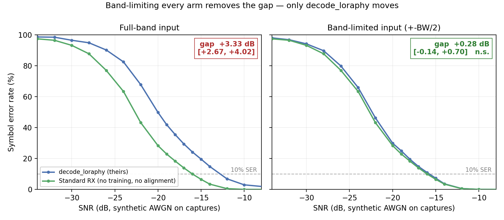
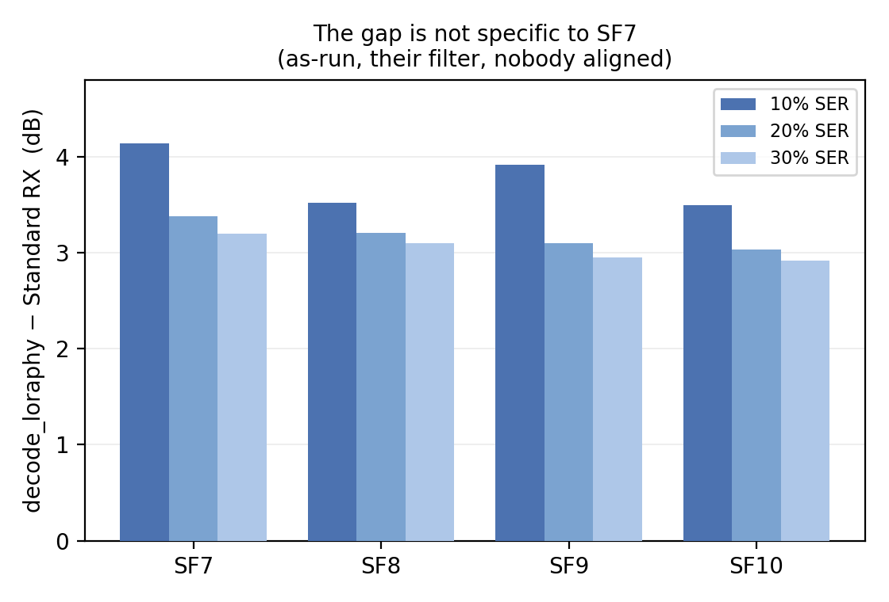
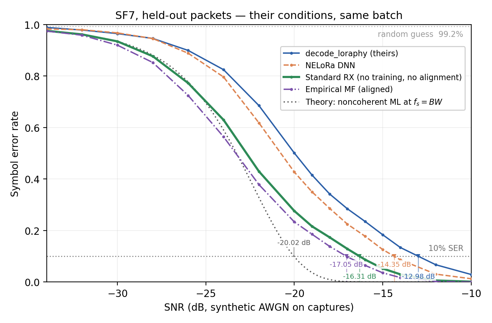

# 검토 요청 — NELoRa 재검증 (3라운드)

2026-09-22 · 전체 내용은 `NELORA.md` · 2라운드 이전 기록은 이 문서 뒤쪽

**상태: 6차 검토에서 원본 LoRaPHY 를 돌려 대조했고, §8 한계 4번이 닫혔다.**
**5차 검토에서는 §5 계열 표가 옛 잡음 규약 값임이 드러나 재측정했다** (`NELORA.md`
§9-13). 대역제한 입력 DNN 까지의 측정은 그대로 닫혀 있고, **마지막까지 CI 가 없던
대역제한 팔도 이번에 닫혔다** (아래 남은 작업 참조).

⚠️ **6차 검토 요약 (2026-09-23).** 그들 baseline 이 **원본 LoRaPHY 의 포팅**이라고 스스로
밝히므로, 원본(Xia et al., ACM TOSN 2022)을 옮겨 같은 held-out·같은 잡음 규약에서
돌렸습니다 (`NELORA.md` §5-12, `verification/loraphy_orig.py`).

| | 10% SER | 부트스트랩 1000복제 |
|---|---|---|
| `decode_loraphy` (포팅본) | −12.98 | — |
| **`loraphy_orig`** (대역제한·리샘플 복원) | **−15.98** | `decode_loraphy` 대비 **+3.02** [+2.49, +3.65] |
| 표준 RX | −16.31 | `loraphy_orig` 대비 **+0.30** [−0.08, +0.73] — 구별 안 됨 |

**원본에 있는 대역 제한·리샘플 두 단계가 포팅본에 없습니다.** 복원하면 +3.02 dB 가
돌아오고 남은 차이는 표준 RX 와 구별되지 않습니다. §5-10(대역제한 입력을 준
`decode_loraphy`, −16.02)과 **0.04 dB** 로 만납니다.

**§8 한계 4번이 닫혔습니다.** "브릭월은 이상 필터라 +3 dB 는 상한" 이라는 유보를 달아
두었는데, 129탭 FIR 로 재니 **+3.10 dB [+2.59, +3.81]** 로 CI 가 겹칩니다. 65탭 이상이면
브릭월과 0.1 dB 안입니다. **상한 추정이 아니라 측정값입니다.**

**같은 회차에서 절차 결함 하나** (`NELORA.md` §9-16, 정정 #17 — #13 과 함께 문서에
들어가기 전에 잡힌 건입니다). 첫 실행의 결과 파일이 쓰인 **22초 뒤에 스크립트를 고쳤고**, 그래서 한
파일 안에서 다섯 팔은 수정 후, 두 팔(FIR·`fast_mode`)은 수정 전 코드의 값이었습니다.
스크립트가 untracked 라 사후 복원도 불가능했습니다. 드러낸 것은 재실행이 아니라 **"129탭
FIR 이 브릭월 대비 2.45 dB 를 잃을 수는 없다"** 는 이론 대조였고, 이상 신호 검사(차이
0.02~0.06 dB)가 기록값 쪽을 가리켰습니다. 헤드라인 다섯 팔은 재실행에서 15개 SNR 전부
소수 첫째 자리까지 같아 **§5-12 의 수치는 그대로입니다.**

---

⚠️ **5차 검토 요약 (2026-09-23).** §9-6 의 잡음 규약 수정이 §7 에만 반영되고 §5 에는
반영되지 않은 채 두 개정을 지나왔다. `sf7_u100.txt` 로 다시 재어 갈아끼웠다:

| | 옛 값 | 새 값 |
|---|---|---|
| as-run D1 − 표준RX (SF7, 10%) | +3.48 | **+3.89** |
| 내역: 제로패딩 / 데시메이션 | 0.69 / 2.79 | **0.60 / 3.29** |
| 필터가 baseline 을 돕는 양 | 1.19 dB | **0.27 dB** |
| U=10 vs U=100 | "동치(0.02 dB)" | **0.25 dB — 등가성 철회** |

결론의 방향은 그대로이고 **데시메이션 몫은 오히려 커졌다**. 다만 §7 의 SF8~10 이 전부
U=10 이므로 그들 기본값(U=100) 기준으로는 ~0.25 dB 낙관적이다 — 아래 남은 작업 참조.

**같은 회차에서 두 건이 더 나왔다** (`NELORA.md` §9-14, 정정 #16):

1. **"SF8~10 무잡음 오류 0.00%" 는 평가셋에서만 참이다.** 데이터셋 전체로는 SF10 의
   `pkt3` 이 52/52 전부 오류인데, 분할상 프로토타입 집합에 들어가 평가셋에 도달하지
   않는다. 측정값은 안 바뀌고 **문장의 범위**만 바뀐다. #10 과 같은 계열(평가셋을 전체
   집합으로 착각)이라 §9 머리말에 패턴으로 묶었다.
2. **헤드라인 상한 D3 의 프로토타입 오염 — 검사했다.** §3 의 고오류 SF7 패킷 다섯 개가
   전부 프로토타입 집합에 있는 것은 사실이나, 프로토타입에서만 빼고 다시 재니 D3 가
   **0.004 dB 이내로** 움직인다. 이 값은 **오염분과 표본 188심볼 감소분의 합**이고 둘을
   분리하지 않았다(분리하려면 깨끗한 패킷 다섯을 비슷한 심볼 수로 무작위 제외해 한 번 더
   돌리면 된다 — 결론이 안 바뀌어 하지 않았다). 다만 합이 그 크기이므로 **"표준 RX 가
   상한의 0.74 dB 안까지 붙는다" 는 과소평가가 아니다.** 대조군은 저장본을 네 팔 모두
   소수 넷째 자리까지 재현했다. 한계가 될 뻔한 항목이 측정으로 닫혔다.

### 문서 구성

| 파일 | 역할 |
|---|---|
| `NELORA.md` | 정식 보고서 — 측정·방법·한계·정정 기록 |
| **`NELORA_REVIEW.md`** | **이 문서.** 최신 검토 패킷. 파일명에 날짜를 붙이지 않는다 |
| `NELORA_HISTORY.md` | 지난 라운드 기록 (숫자는 그 시점 것이므로 인용 금지) |
| `verification/` | 스크립트와 결과 JSON. `results/` 에 측정본, `nelora_dnn_report.py` 로 읽는다 |

### 남은 작업

- ~~SF8/9/10 as-run 재측정~~ — **끝났다.** 잡음 규약 수정본으로 SF7~10 전부 다시 쟀고
  `NELORA.md` §7 을 갱신했다. 10% 에서 **+3.50 ~ +4.14 dB** (아래 그림 2).
- 그림 세 장을 `nelora_figs.py` 로 만들어 `NELORA.md` 에 넣었다.
- ~~DNN 팔 SNR 격자 확장~~ — **끝났다.** 세 팔 모두 −34 dB 까지, 곡선이 포화까지 보인다
  (`ext_sf7_{plain,lpf,dnn}.json`). 확장분이 원래 측정을 겹치는 15개 SNR 에서 0.1%p
  이내로 재현하므로, 체크포인트·모집단이 같다는 확인도 겸한다.
- **SF8~10 을 U=100 으로 재측정** — 5차 검토에서 새로 생긴 항목. §7 은 전부 U=10 이고
  SF7 통제 비교에서 U=10 이 0.25 dB 낙관적이었다(`NELORA.md` §5-8). SF8~10 도 같은
  방향일 것으로 보지만 재지 않았다. 비용은 SF 당 U=10 의 ~10배.
- **SF10 의 재현 변동** — 모집단이 같은 두 블록이 0.47 dB 어긋났다(`NELORA.md` §7).
  SF10 값에 CI 가 없어서 이 변동의 크기를 모른다. 부트스트랩을 돌리면 닫힌다.
- **SF7 의 배경 오류** — 무잡음 오류가 146패킷(79.3%)에 1~3심볼씩 깔려 있는데, 통째로
  밀린 패킷(§6)으로 설명되는 것은 그중 31.7% 뿐이다. 나머지의 원인은 규명하지 않았다.
- 브릭월을 실제 FIR(`scipy.signal.firwin`, 64~128탭)로 바꿔 "+3 dB 는 상한에 가깝다" 를
  측정값으로 만들기 (선택).
- ~~대역제한 팔의 CI~~ — **끝났다.** SNR 격자를 −10 dB 이하로 좁혀(11점) 재실행했다.
  표준RX − DNN **+0.79 [+0.28, +1.44]**, DNN − 자기 baseline **−0.54 [−1.05, −0.10]**
  — 둘 다 유의하고, 판정 기준의 첫 번째 갈래라 §5-11 문장은 그대로다(`NELORA.md` §9-14b).
  꼬리는 −9.31 → −1.44 로 정상화됐다. **소요는 ~10분이 아니라 36분**이었다.
- SF8~10 의 held-out·DNN 비교는 여전히 안 했다 (SF7 만). 하지 않기로 한 근거는
  `NELORA.md` §8 에 있다.

### 그들 소스를 다시 받아야 할 때

```bash
git clone --depth 1 https://github.com/daibiaoxuwu/NeLoRa_Dataset.git   # Bench, 우리가 쓰는 릴리스
git clone --depth 1 https://github.com/AIoT-MLSys-Lab/NELoRa.git        # SenSys, MATLAB 평가 행렬
```

SenSys 쪽 `matlab/evaluation/*.mat` 에 그들 SF7 곡선이 있다 (`error_matrix` 는 이름과
달리 **정확도**다 — `evaluation.m` 이 `1-error_matrix` 를 그린다). 체크포인트·데이터셋은
Bench README 의 Google Drive 링크.

---

## 0. 지난 검토 지적 처리 결과

| # | 지적 | 결과 |
|---|---|---|
| 1 | 문서 안 모순 문장 5곳 | **정리.** 헤드라인을 §5-4 하네스 하나로 통일, "재현" → "수준에 도달" |
| 2 | 같은 검출기가 두 하네스에서 2.2 dB 다름 | **원인 규명.** 버그 **둘**이었다 (§1) |
| 3 | 헤드라인에 CI 없음 | **붙였다.** 부트스트랩을 2단계로 바꿔 1000복제가 몇 초 (§2) |
| 4 | 데시메이션 + DNN 을 함께 쓰면? | **둘 다 쟀다.** 검출기 §3(격차의 **대부분이 설명**, 잔차 ≤0.7 dB), 신경망 §5 — DNN 이 자기 baseline 보다 0.53 dB 뒤진다(**−0.54 [−1.05, −0.10], 유의**) |
| 5 | held-out, 학습곡선, 겹친 프로세스 | **전부 해결** (§4) |

---

## 0-b. 4라운드 지적 처리 결과 (10건, 전부 반영)

측정은 다시 하지 않았습니다 — **같은 측정을 문서가 어긋나게 적고 있던 것**이라
`NELORA.md` §9-11 에 측정 정정 **열세 건**과 **번호를 분리해** 적었습니다.

| # | 지적 | 처리 |
|---|---|---|
| 1 | DNN 값이 −14.35 / −14.26 두 개 | 체크포인트가 다르다 — 헤드라인 **최종**, §5-11 **검증 최고 ep77**, 0.09 dB. 각주 추가. 덤으로 **헤드라인 네 숫자가 본문 어느 표에도 없던 것**을 찾아 §5-4 에 held-out 표를 넣었다 |
| 2 | +2.05 가 두 뜻 | 헤드라인 macro / §5-11 micro 가 **우연히 같은 값**(둘 다 2.048)임을 명시 |
| 3 | macro +1.50 vs +1.45 | 전량 평가·다른 체크포인트(§5-6) vs held-out(§5-4). 출처를 둘 다 붙였다 |
| 4 | §9-8 상호참조 깨짐 | 정정 **#6**(정규화 누락, 본문 §5-4)으로 정정 |
| 5 | +1.25~+1.75 반올림 | **+1.28 ~ +1.73** 실측값으로. 대역제한 행도 eval −0.53 / train −1.81 병기 |
| 6 | 모드 선택 원칙이 절마다 반대 | 헤드라인을 **+1.60 ~ +2.05 dB 범위**로. 그들 조건(train)인 +1.96 과 DNN 최선(eval, ep77)인 +1.60 을 함께 적는다 |
| 7 | 귀무를 "확정" 으로 | **"대부분 설명된다 (잔차 ≤0.7 dB)"**. §5-10 본문에도 같은 문단 추가 |
| 8 | 요약표 −0.53 에 CI 부재 표시 없음 | **(점추정, CI 미산출)** 명기 |
| 9 | 유리/불리 목록이 한쪽만 | **반대 방향 한 건** 추가 — 대역제한 팔은 이어 학습, `--scratch` 대조 없음 |
| 10 | §8 한계1 이 문서와 충돌 | "절대 dB 인용 금지" → **"절대 dB 를 물리적 SNR 로 해석하지 말 것"** |
| + | (그림을 고치다 드러난 것) 확장 측정에 `--batch 16` 누락 | 잡음 공유 단위가 64 가 되어 교차점이 0.2~0.3 dB 어긋나 있었다. 다시 돌려 저장본과 완전 일치. **측정 정정 13번**(§9-6 (c)) |

6번 권장안은 **+1.60 ~ +1.96** 이었는데 **+1.60 ~ +2.05** 로 썼습니다. 검증 최고
에포크 · train 모드가 +2.05 여서, 최댓값을 빼면 범위가 다시 선택이 됩니다.

---

## 1. 2.2 dB 의 정체 — 1/√2 가 아니라 버그 둘

`amp` 를 심볼별로 계산하고 있었습니다(그들은 배치 전체). 캡처 진폭이 표준편차 2.73 dB,
하위 5% 가 −5.90 dB 로 흩어져 있어, 평균보다 조용한 심볼이 표기 SNR 보다 나쁜 실효
SNR 을 받습니다. 심볼별로 하면 곡선이 통째로 2.2 dB 낙관적이 됩니다.

그걸 고치니 **두 번째가 드러났습니다** — 잡음을 평가셋 **전체에 한 번만** 뽑고
있었습니다. 그들은 `DataLoader` 배치(16)마다 하나씩 뽑습니다. 독립 실현이 ~110배 줄어
CI 가 `[+3.88, +4.48]` → `[+2.35, +5.96]` 로 폭발했고, 그게 증상이었습니다.
배치 단위로 고치니 복구됐습니다.

남은 차이는 **모집단**입니다. `nelora_dnn_eval` 은 그들 `load_data` 그대로 전량(preamble
포함), `nelora_asrun` 은 payload 만 + 패킷 분리. 그래서 헤드라인은 §5-4 하나로 통일하고
§5·§7 은 보조로 내렸습니다.

---

## 2. 부트스트랩 — 2단계로 바꿔 1000복제

말씀대로 잡음 재추출이 구간을 안 넓히므로 나눴습니다.

- **1단계(비쌈)**: 잡음 실현 R=10 개만 뽑아 검출기별 **심볼별 정오답**을 한 번만 계산
- **2단계(공짜)**: 패킷 재표집은 그 배열 인덱싱만 — 1000복제가 몇 초

비용이 1/10 로 줄고 복제는 100 → 1000 으로 늘었습니다. 100복제 백분위는 양 끝이 표본
2~3개로 정해져 불안정한데, 1000이면 표준적입니다.

주의 둘도 반영했습니다: **배치는 16 고정**(train 모드 BatchNorm 이 배치 통계를 쓰므로
키우면 답이 바뀜), **Dropout 시드를 실현마다 고정**(무작위성이 실현의 일부가 되고 재현됨).
D1 FFT 는 `scipy.fft(workers=-1)`.

---

## 3. 핵심 — 대역제한 입력을 모두에게 주면 격차가 사라진다

원래는 "DNN 에도 같은 조건을 주면?" 을 보려던 실험인데, **검출기 쪽에서 더 깨끗한
확인**이 나왔습니다. held-out 18패킷 / 1353심볼, 10% SER:

| 검출기 | 필터 없음 | 대역제한 입력 | 변화 |
|---|---|---|---|
| `decode_loraphy` | −12.98 | **−16.02** | **−3.03** |
| 표준 RX | −16.31 | −16.31 | +0.00 |
| D2 이상적 MF | −16.96 | −16.93 | +0.03 |
| D3 경험적 MF | −17.05 | −17.02 | +0.03 |

```
decode_loraphy − 표준 RX  (필터 없음)  +3.33 dB  [+2.67, +4.02]  유의
decode_loraphy − 표준 RX  (대역제한)   +0.28 dB  [−0.14, +0.70]  0 과 구별 안 됨
```



*그림 1 — 입력에만 ±BW/2 브릭월(잡음 → LPF → 정규화). 움직이는 것은 `decode_loraphy`
하나뿐입니다. D2/D3 는 두 패널에서 겹쳐 보여 뺐습니다. 축은 포화까지 — SNR 격자를
−34 dB 까지 늘려 SER 이 랜덤 추측(99.2%)에 닿는 것을 보입니다.*


**+3.33 dB 가 사라지고, 움직인 것은 `decode_loraphy` 하나뿐입니다.** 표준 RX 는 이미
같은 필터를 내부에서 걸고, D2/D3 는 전대역 MF 라 대역 밖 잡음을 원래 배제하니 변할
이유가 없습니다.

§5-1 은 표준 수신기를 만들어 비교한 것이고, 이쪽은 그들 baseline 에 대역제한 입력만
준 것인데 같은 결론에 닿습니다. **독립적인 두 번째 확인**이고, **학습·정렬·프로토타입을
전혀 쓰지 않습니다.** 지금 가장 방어하기 쉬운 결과입니다.

---

## 3-b. SF7~10 — 격차는 SF7 특수한 것이 아니다

잡음 규약 수정본(배치 16 단위 amp·공유 잡음)으로 네 SF 를 다시 쟀습니다. as-run 조건,
아무도 정렬을 받지 않습니다. SF 마다 SNR 격자를 3 dB 씩 내립니다 — 안 내리면 곡선이
10% 에 닿기 전에 끝나 "교차 없음" 으로 읽힙니다(§7 의 재발 항목).



*그림 2 — `decode_loraphy` − 표준 RX. 10% 에서 +3.50~+4.14 dB, 20/30% 에서 +2.92~+3.38 dB.*

임계를 올릴수록 값이 내려가는 것은 바닥 효과입니다. 헤드라인을 ~3 dB 로 쓰는 근거가
이 안정적인 20/30% 쪽입니다.

---

## 4. held-out 과 재학습 — 전부 갖춰졌습니다

`random_split` 이 torch 시드를 안 잡아 held-out 이 불가능했던 문제를, 그들 `main.py` 를
패치해(`nelora_lpf_patch.py`) **시드 고정 + 패킷 단위 9:1 분할 + 인덱스 저장**으로
풀었습니다. 18패킷 / 1353심볼. 같은 패킷 심볼이 양쪽에 들어가지 않으므로 그들 심볼 단위
분할보다 엄격합니다.

held-out, 재학습 DNN, 1000복제:

| 격차 | 중앙값 | 95% CI |
|---|---|---|
| **표준 RX 가 DNN 보다** | **+1.96 dB** | [+1.31, +2.59] |
| 〃 (체크포인트·모드 전부에 걸쳐) | **+1.60 ~ +2.05 dB** | — |
| D3 가 DNN 보다 | +2.74 dB | [+2.15, +3.31] |
| DNN 이 baseline 보다 | +1.35 dB | [+0.70, +1.97] |
| 표준 RX 가 baseline 보다 | +3.33 dB | [+2.67, +4.02] |

DNN 이 held-out 에서도 **+1.36 dB (macro +1.45)** 로 그들 발표 SF7(+1.46) 수준입니다.

세 체크포인트를 구분해 적었습니다(지난 판에는 없었습니다) — 헤드라인은
`ckpt_sf7_plain` **최종**(−14.35), §5 표는 같은 학습의 **검증 최고 에포크 ep77**(−14.26),
본문 §5-6 의 +1.39/+1.50 은 그들 `train()` 으로 100에포크 이어 학습한 `ckpt_sf7` 를
**전량 평가**한 값입니다. 헤드라인 숫자가 본문 어느 표에도 없던 것도 고쳤습니다
(`NELORA.md` §5-4 에 held-out 표를 넣었습니다).

그리고 헤드라인은 **train 모드**(그들 `test()` 조건)이고 §5 는 **eval/train 중 나은 쪽**을
씁니다. 원칙이 절마다 달라 보이므로, 헤드라인을 한 값이 아니라 **+1.60 ~ +2.05 dB
범위**로 바꿨습니다 — 어느 조합을 고르든 표준 수신기가 앞섭니다.
"as-run 이라 DNN 에 유리했다" 는 단서가 필요 없어졌습니다.



*그림 3 — 같은 held-out 의 SER 곡선. 10% 선 교차가 −12.98 / −14.35 / −16.31 / −17.05 dB.
회색 점선(D3)이 상한이고, 학습도 정렬도 없는 표준 RX 가 그 0.74 dB 안까지 붙습니다.
세 팔 모두 −34 dB(포화)까지 쟀고, 겹치는 15개 SNR 이 원래 측정과 0.1%p 이내입니다.
**표준 RX 가 전 구간에서 DNN 아래**이고, −28 dB 아래에서는 DNN 이 baseline 으로 수렴합니다.*


겹쳐 돌던 학습 프로세스 문제도 체크포인트 디렉터리 분리로 해결했습니다.

---

## 5. 대역제한 입력 DNN — 닫혔습니다

400에포크로 연장해 수렴을 확인했고, 두 팔 모두 최고 에포크로, train/eval 두 모드로
다시 쟀습니다.

### 수렴 (귀무 결과를 쓰기 전 필수 조건)

**ep144 = 0.836 vs ep398 = 0.837.** 250에포크를 더 돌려 0.001 올랐습니다.
마지막 100에포크 기울기 +0.003 %p/에포크, 마지막 150에포크 누적 +0.09 %p. 고원입니다.
150에포크 판에서 제가 "아직 오르고 있다" 고 본 것은 짧은 창의 잡음이었습니다.

### 결과

| 실행 | baseline | **DNN** | 표준 RX | D3 (상한) | 표준RX − DNN |
|---|---|---|---|---|---|
| 필터 없음 / train | −12.98 | −14.26 | −16.31 | −17.05 | +2.05 |
| 필터 없음 / eval | −12.98 | −14.71 | −16.31 | −17.05 | +1.60 |
| 대역제한 / train | −16.02 | −14.21 | −16.31 | −17.02 | +2.10 |
| **대역제한 / eval** ← DNN 최선 | −16.02 | **−15.49** | −16.31 | −17.02 | **+0.82** |

§5-9 판정표로는 **"표준 RX 에도 못 미침"** 입니다.

### 가장 말이 되는 지표 — 자기 baseline 과의 관계

| | DNN − 자기 baseline |
|---|---|
| 필터 없음 | **+1.28 ~ +1.73 dB** (DNN 이 앞섬) |
| 대역제한 | **−0.53 dB** (eval) / −1.81 dB (train) — 둘 다 DNN 이 뒤짐 |

**신경망이 벌던 이득의 정체가 대역 밖 잡음 배제였고, 그 일을 브릭월 필터보다 못하게
해내고 있었습니다.** §5-10 이 검출기만으로 보인 것을 신경망을 넣어서도 확인합니다.
본편 §4.2 예측과 일치합니다.

### 이 결과는 DNN 쪽으로 기울어 있습니다

- 에포크 비대칭: 필터 없음 150 / **대역제한 400**
- 최고 에포크를 **평가에 쓰는 바로 그 held-out** 으로 선택 (선택 편향이 DNN 쪽)
- train / eval 중 **나은 쪽**을 DNN 값으로 사용

셋 다 DNN 에 유리한데도 집니다.

**반대로 DNN 에 불리한 항목도 하나 적어 둡니다** — 대역제한 팔은 필터 없는 입력에
맞춰진 체크포인트에서 **이어 학습**한 것이고 `--scratch` 대조가 없습니다. §5-9 에서
결과를 보기 전에 스스로 위험으로 지목한 항목입니다. 400에포크 고원이 상당 부분
방어하지만, 처음부터 학습하면 더 갈 가능성은 측정으로 배제하지 못했습니다.

### CI 는 인용하지 않습니다

대역제한 팔의 부트스트랩 꼬리가 −9 dB 까지 늘어납니다. 원인은 **학습 SNR 범위 밖**
입니다 — 그들 `snr_range` 는 −30~0 인데 +10/+5 dB 에서 DNN 이 96% 바닥을 보입니다
(고전 팔은 100%). SER 곡선이 비단조가 되어 복제마다 가짜 교차가 생깁니다.

점추정은 영향이 없습니다. 임계는 −15~−16 에서 지나고 그 구간은 학습 범위 안이라
단조롭습니다. `cross_np` 를 '마지막 교차' 로 고쳤고, 세 실행 모두 첫/마지막이 점추정에서
동일함을 확인했습니다. 타이트한 CI 가 필요하면 SNR 격자를 −10 이하로 좁혀 재실행하면
됩니다(각 ~10분). 필터 없는 팔의 CI(§4)는 정상입니다.

### 덤 — eval 모드가 이제 더 낫습니다

| | train | eval |
|---|---|---|
| 필터 없음 | −14.26 | **−14.71** |
| 대역제한 | −14.21 | **−15.49** |

공개 체크포인트에서는 train 모드가 eval 보다 1.5 dB 나았는데(BatchNorm running
statistics 미수렴), 400에포크 제대로 학습하니 뒤집혔습니다. §5-5 의 관찰이
"학습 부족의 징후" 였다는 해석이 뒷받침됩니다.

---

## 5-b. 대역제한 입력 DNN 의 CI — 판정 기준 (실행 전에 적는다)

7차 검토 지시로 §5-11 의 세 비교에 부트스트랩 CI 를 붙인다. **숫자를 보기 전에** 기준을
적어 둔다. §5-9 · `NELORA.md` §9-14b 와 같은 방식이다.

### 부호 규약 — 이것부터

스크립트가 찍는 `A − B` 는 **10% SER 교차점의 차**다(`cross(A) − cross(B)`, 단위 dB).
교차점은 음수 SNR 이고 **더 좋은 검출기가 더 낮은(더 음수인) 값**을 갖는다. 따라서

| 부호 | 뜻 |
|---|---|
| `A − B` > 0 | A 가 더 높은 SNR 을 요구한다 → **A 가 뒤진다** |
| `A − B` < 0 | **A 가 앞선다** |

세 비교 모두 `A` 가 고전 팔이고 `B = nelora_dnn` 이므로, **음수면 신경망이 뒤진다.**

### 비교 셋과 세 갈래

| | 비교 (스크립트 출력 이름) | 신경망이 뒤지는 쪽 |
|---|---|---|
| (a) | `standard_rx − nelora_dnn` | 음수 |
| (b) | `decode_loraphy − nelora_dnn` (대역제한 입력) | 음수 |
| (c) | `D3_aligned − nelora_dnn` | 음수 |

각 비교를 **결과를 보기 전에 정한 세 갈래**로만 읽는다:

1. **CI 가 전부 신경망이 뒤지는 쪽** (상한 < 0) → "**유의하게 못 미친다**". §5-11 결론 유지.
2. **CI 가 0 을 포함** → "**점추정에서 못 미치나 0 과 구별되지 않는다**". 점추정은 그대로
   쓰되 유의 주장은 철회한다.
3. **CI 가 전부 신경망이 앞서는 쪽** (하한 > 0) → **§5-11 결론 수정 대상**. 본문을 고친다.

**(c) 가 3번 갈래면 별도로 전제를 점검한다.** D3 는 경험적 정합필터 + 정렬이라 이 보고서가
**판정 상한**으로 쓰는 팔이다(§5-9). 신경망이 그것을 유의하게 넘으면 "심볼 단위 front-end 는
정합필터를 넘을 수 없다"(본편 README §4.2)와 충돌하므로, 결과를 쓰기 전에 D3 프로토타입
커버리지·정렬·오염(§9-14)부터 다시 본다.

### 실행 조건 (고정)

| 항목 | 값 |
|---|---|
| SF / 평가셋 | SF7, held-out `split_sf7_test.npy` (18패킷 / 1353심볼) |
| 배치 | **16** (§9-6 — 잡음이 배치 단위로 공유되므로 선택이 아니다) |
| 잡음 | 그들 규약 (`--noise-mode theirs`, 정규화 켬), 실현 **10회** |
| 부트스트랩 | 패킷 재표집 **1000복제**, 2단계 방식 (§9-10 — 복제마다 재계산하지 않는다) |
| 대역제한 | **모든 팔 입력에 동일한 ±BW/2 브릭월**, 잡음 → LPF → 정규화 순서 (학습과 동일) |
| 팔 | `decode_loraphy`, `standard_rx`, `D2_aligned`, `D3_aligned`, `nelora_dnn` |
| 체크포인트 | `ckpt_sf7_lpf/398_*` (대역제한 400에포크 학습의 최고점). **재선택 금지** |
| 모델 모드 | **train · eval 둘 다** 돌린다 |
| SNR 격자 | −10, −12, −14, −15, −16, −17, −18, −19, −20, −22, −24 |

**신경망의 값은 "두 모드 중 교차점이 나은 쪽"** 이다 — §5-11 이 이미 쓰고 있는 규칙이고,
그쪽이 신경망에 유리하다. 모드를 결과를 보고 고르는 것이 아니라, **규칙이 먼저 있고 그
규칙이 고르게 한다.** 나머지 네 팔은 두 실행에서 같은 시드를 쓰므로 값이 같아야 하고,
같지 않으면 실행 조건이 어긋난 것이다(확인 항목).

**+10 / +5 dB 를 뺀 이유.** 그들 `snr_range` 는 −30~0 dB 인데 학습 범위 밖에서 신경망이
무너져 SER 곡선이 비단조가 되고, 부트스트랩 꼬리가 −9 dB 까지 늘어났다(`NELORA.md` §5-11).
격자를 −10 dB 이하로 좁히면 그 가짜 교차가 사라진다.

### 출처 (§9-16 이후 규칙)

스크립트를 **먼저 커밋한 뒤** 실행하고, 결과 JSON 에 `provenance`(모듈 sha256 ·
`git_head` · `git_dirty` · `run_utc`)를 남긴다. 결과는 **새 이름** `results/lpf_dnn_ci.*`
로 쓴다 — 기존 `results/lpf_ci.*` 는 5차 검토의 **eval 모드 단독** 실행이고 `provenance`
가 없다(`NELORA.md` §9-14b 가 인용하고 있다). 덮어쓰지 않는다.

> ⚠️ **이 측정은 부분적으로 이미 있다.** `results/lpf_ci.*` 가 (a)(b)(c) 세 CI 를 모두
> 담고 있고, (a)(b) 는 `NELORA.md` §0 · §9-14b 에 이미 인용돼 있다. 이번 실행이 더하는
> 것은 **train 모드를 같은 조건에서 함께 잰 것**, **`provenance`**, 그리고 **독립 재현**
> 이다. 기존 값과 어긋나면 그 자체가 보고 대상이다.

---

## 6. 여기를 쳐주시면 됩니다

1. **"충분히 학습했는가" 는 결국 곡선으로만 뒷받침됩니다.** ep144→ep398 이 +0.001 이라
   고원이라고 봤지만, 이보다 강한 근거는 구조적으로 없습니다. 다른 학습률·구조로는
   더 갈 수도 있다는 반론은 남습니다.
2. **§5-10 의 `decode_loraphy` 대역제한 조건은 그들 파이프라인에 없는 조건입니다.**
   "그들 baseline 이 이렇게 하면 좋아진다" 는 우리가 만든 반사실이지 그들 수치가 아닙니다.
3. **SF8/9/10 은 as-run 조건뿐입니다** — 잡음 규약 수정본으로 다시 쟀지만(+3.50~+4.14 dB,
   그림 2), held-out·DNN 비교는 SF7 에서만 했습니다. 고SF 에서 DNN 이 다르게 행동할
   가능성은 측정으로 배제하지 못했습니다.
4. `.eval()` 건은 여전히 사실로만 두고 단정하지 않습니다.
5. SNR 축은 합성 AWGN 입니다(그들도 그렇습니다).

---

## 7. 방법론 — 3라운드 누적

수치가 어긋났을 때 원인은 **예외 없이 제가 재구현한 쪽**이었습니다
(그들 코드가 무결하다는 뜻은 아닙니다 — 데시메이션 생략, `upsampling=100`,
`test()` 의 `.eval()` 누락, 전량 평가, 배치 공유 잡음, baseline 이 게이트키퍼인 필터는
`NELORA.md` §9 에 따로 적었습니다). 지금까지 여덟 건:
cumsum 생성기, de-chirp/대역 순서, 정규화 누락, `.eval()` 호출, 심볼별 amp,
잡음 실현 단위, 심볼 읽는 순서, 원본 LoRaPHY 팔의 FIR 차단주파수·반앨리어싱.
일곱 번째는 `IndexError` 가 우연히 드러냈고, 아니었으면 **에러 없이 틀린 답**이
나왔을 겁니다.

**여덟 번째는 성격이 다릅니다** (`NELORA.md` §9-16). 고친 것 자체보다, **고치고 다시
돌리지 않아** 기록 파일에 수정 전 값이 남은 것이 문제였습니다 — 한 파일 안에서 다섯
팔은 수정 후, 두 팔은 수정 전 코드의 값이었고, 스크립트가 untracked 라 사후에
복원할 수도 없었습니다. 드러낸 것은 재실행이 아니라 **숫자의 크기가 필터 이론과
맞지 않는다**는 지적이었습니다.

규칙 여섯으로 남깁니다:

- 새 검출기 팔은 **이상 신호 온전성 검사**를 먼저 통과시킨다.
- 남의 수치와 비교하기 전에 **그 수치를 낸 코드를 읽는다.**
- **재구현이 맞는지는 재구현끼리 비교해 알 수 없다. 원본을 돌려서 대조한다.**
- 패치 생성물·인라인 구현은 **넘기기 전에 원본과 수치 대조한다.**
- **결과를 쓴 뒤 스크립트를 고쳤으면 다시 돌린다.** 측정을 낸 스크립트는 커밋한
  뒤에 돌린다.
- **숫자의 크기를 이론과 대조한다.** 검증된 팔과 검증 안 된 팔이 어긋나면, 검증 안
  된 쪽을 먼저 본다.
