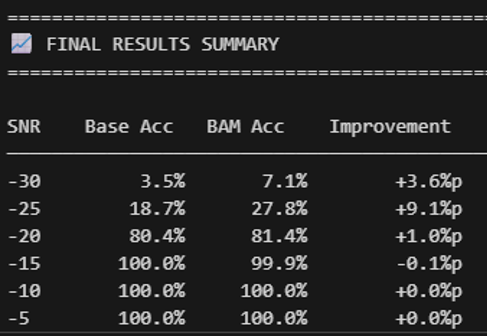
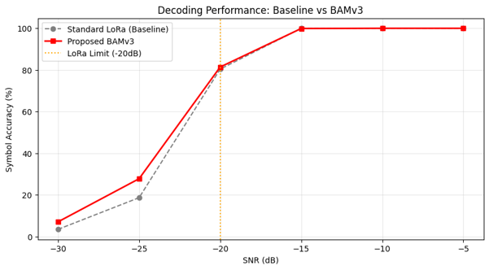
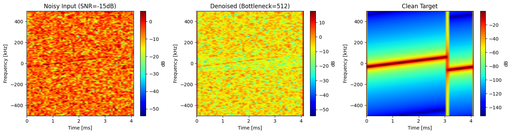
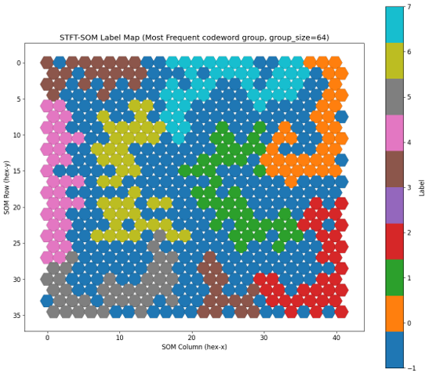

# 아카이브 — Complex-valued BAM 궤적 (2025.09 – 2026.01)

> **이 폴더의 결과는 전부 철회됐다.** 보존하는 이유는 결과가 아니라 **궤적**이다 —
> 무엇을 시도했고, 왜 개선처럼 보였고, 재검증에서 어떻게 무너졌는지.
> 살아 있는 결론은 본편 [`../README.md`](../README.md) 와
> [`../NELORA.md`](../NELORA.md) 에 있다.

이 저장소는 "초저 SNR LoRa 복조 성공률을 올리기 위해 Complex-valued BAM
(Bidirectional Associative Memory) 기반 신호 복원을 붙인다" 는 설정에서 출발했다.
`01`–`07` 폴더가 그 실험 순서를 그대로 보존한다.

재검증 결과 **그 설정 자체가 닫혀 있었고**(본편 §4), 개선처럼 보인 것의 정체는
**baseline 이 스스로 버리고 있던 구현 손실의 일부를 신경망이 되찾아 준 것**이었다
(본편 §3). 그래서 이 폴더는 아카이브다.

무엇이 왜 철회됐는지는 **본편 README §3 과 §4.1** 에 적혀 있다. 여기서는 그 결론을
반복하지 않고, 아카이브된 코드를 읽는 데 필요한 것만 남긴다.

---

## 1. 당시의 접근

- **Complex-valued BAM 설계**
  - 가중치 `W_uv`, `W_vu` 를 실제 복소수로 유지 (실수 concat 아님).
  - 활성함수는 **split-tanh** — IEEE 논문의 Lagrange 안정성 조건을 만족하도록 선택.
  - 동역학은 Euler 적분으로 forward-backward 를 반복.
- **구조 실험**
  - Noise2Noise 자가지도 학습
  - 스킵 커넥션 / outer residual / tied-untied encoder 등 다수 변형
  - Complex 스펙트로그램 입력 · IQ 직접 입력 두 도메인 모두 시도

공통 설정: SF = 9 (심볼 512개), fs = 1 MHz, 잡음은 AWGN.

## 2. 1차 결과 (BAMv3 + Noise2Noise) — **철회**

일부 초저 SNR 구간에서 repo 내 baseline 대비 개선이 관측되었다.



- −30 dB: 3.5% → **7.1%** (+3.6%p)
- −25 dB: 18.7% → **27.8%** (+9.1%p)



**복원 예시 (SNR = −15 dB, Complex spectrogram 도메인)**


좌: 잡음 입력 · 중: BAM 복원 (bottleneck=512) · 우: 클린 타깃.
Chirp 궤적은 일부 살아나지만 진폭 collapse 가 남아 있다.

> **철회 근거 (본편 §3.2).** 같은 잡음 실현에서 **대역제한 후 데시메이션한
> dechirp+FFT** 를 baseline 으로 쓰면 −25 dB 정확도가 51.6% [50.4, 52.9] 다.
> BAMv3 의 27.8% 는 거기에 크게 못 미친다. 위 +9.1%p 는 최적 검출기를 넘어선 것이
> 아니라, 이 저장소의 baseline 이 **대역제한 없이** BW-rate 알고리즘을 OSF=4 에서
> 그대로 돌려 버리고 있던 손실의 일부였다. 올바른 baseline 앞에서는 남지 않는다.

## 3. 당시의 종료 근거 (SOM 군집 실패) — **철회**

처음에는 "초저 SNR LoRa IQ 는 심볼 구분 정보를 담고 있지 않다" 는 결론을 SOM
실험에서 끌어냈다.



SOM 격자 위에서 같은 label 이 연속 영역을 이루지 못하고 파편화된 것은 **사실**이다.

> **철회 근거 (본편 §4.1).** LoRa 심볼 집합은 설계상 서로 거의 직교하며
> (`|cos|` 평균 0.0035), 따라서 IQ 공간에서 거의 완전한 등거리 배치다 (거리비
> 1.0218). SOM 은 **SNR = +∞ 에서도** 군집을 만들 수 없다. 관측은 맞았지만
> 거기서 끌어낸 결론이 틀렸다. `verification/verify.py` 가 이를 직접 재측정한다.

---

## 4. 폴더별 — 무엇을 시도하고 무엇이 막혔나

폴더는 **실험 시간 순**이며, 이름에 그 시점의 접근이 드러난다.
`01 → 07` 순서로 읽으면 1차 결과까지의 코드 궤적을 따라갈 수 있다.
전부 `archive/bam-trajectory/` 한 곳 아래에 있다 — 7개로 흩어져 있던 것을 한 폴더로
묶었다 (내용은 안 건드렸다, `git mv` 라 이력도 그대로 따라간다).

```
archive/
├── README.md                              # 이 문서
└── bam-trajectory/
    ├── utils/                             # 공용: LoRa 클래스, BAM 구현, 심볼 추정
    ├── 01_baseline_stft-magnitude-bam/    # STFT magnitude(dB) + MultiBAM
    ├── 02_bam-v3_complex-spectrogram/     # Complex 스펙트로그램 + MultiBAMv3
    ├── 03_bam-v4_tied-autoencoder/        # Tied AE 구조
    ├── 04_bam-v5_untied-residual-huber/   # Untied + outer residual + Huber
    ├── 05_bam-v6_residual-fc-blocks/      # Residual FC block 스택
    ├── 06_bam_complex-iq-direct/          # 단층 Complex-Valued BAM (IQ 직접 입력)
    ├── 07_noise2noise/                    # Noise2Noise 학습 (1차 결과)
    ├── simulation_theory/                 # 복소수 활성함수(modReLU, zReLU) 시각화
    └── local/                             # 위 그림들
```

### 01_baseline_stft-magnitude-bam/ — 실수 도메인 baseline
- IQ → STFT → BW crop → **magnitude(dB) / magnitude flatten** 위에서 BAM 학습.
- 결과: 모든 SNR 에서 baseline 과 동률 또는 낮음. Complex 정보 소실이 원인으로
  추정 → 다음 폴더에서 complex 도메인으로 이동.

### 02_bam-v3_complex-spectrogram/ — Complex 스펙트로그램 진입
- Complex STFT (real/imag concat 7936-dim) + `MultiBAMv3` (Torch, identity 활성,
  target-driven W 갱신, weight decay + grad clip).
- BW = 250 kHz, OSF = 4.
- **출력 collapse 관측** — 입력이 달라져도 출력이 상수 근처로 수렴, 정답률 0.0~0.4%.

### 03_bam-v4_tied-autoencoder/ — Tied AE 로 재파라미터화
- `W_dec = W_enc^T` 로 묶고 leaky_relu + MSE + Adam.
- 같은 collapse 재현. **단일 심볼 디버깅에서 복원 peak 이 clean 대비 0.2% 수준**
  → 진폭 붕괴가 학습 목적함수 수준의 문제임을 확인.

### 04_bam-v5_untied-residual-huber/ — Outer residual + Huber
- `x + α·δ` outer residual 과 Huber loss 로 collapse 방지.
- collapse 는 해결. 그러나 모든 SNR 에서 baseline 보다 낮음
  (예: −20 dB baseline 99.4% vs BAM 74.1%).

### 05_bam-v6_residual-fc-blocks/ — 깊이 확장
- Encoder/decoder 를 `ResidualFCBlock` 스택으로 확장, `residual_alpha` epoch 스케줄.
- baseline 과 거의 동률. 깊이만 늘려서는 개선되지 않음이 확인됨
  → **여기서 "구조 실험" 라인 중단.**

### 06_bam_complex-iq-direct/ — 도메인 축소 (스펙트로그램 → IQ)
- 단층 **Complex-Valued BAM** (`ComplexIQBAM`). split-tanh + gain clamp + anchor.
- IQ 를 직접 입력받아 dv/dt·du/dt Euler 동역학으로 복원.
- Complex-valued 가중치 자체의 표현력이 문제인지 검증하기 위한 축소 실험.
- **사후 평가:** 본편 §5.2 에 의해 이 구조는 CFO 여지에도 구조적으로 도달할 수
  없다. 여지가 심볼 내부가 아니라 **심볼들 사이**에 있기 때문이며, 표현력이 아니라
  관측 범위(심볼 1개)가 한계였다.

### 07_noise2noise/ — 1차 결과가 나온 지점
- 02 와 동일 파이프라인(Complex 스펙트로그램 + `MultiBAMv3`)을
  **Noise2Noise 자가지도**로 재학습.
- 아키텍처는 2-layer 로 단축 (7936 → 2048 → 512), 학습 SNR U(−7.5, 0), 30 epochs.
- **위 §2 의 결과표/그래프가 이 실험에서 나온 것.**
- 당시에는 개선 상한을 이해하기 위해 SOM 분석으로 넘어갔고, 그 해석은 §3 에서
  철회되었다.

### simulation_theory/
- modReLU, zReLU 복소수 활성함수의 magnitude/phase 시각화. 활성함수 선택의 근거.

### utils/
- `LoRa.py` — LoRa 심볼 생성/AWGN + BAM 계열 전 구현 (`BAM`, `MultiBAM`, `BAMv3`,
  `BAMv3_Huber`, `BAMv4`, `MultiBAMv5`, `MultiBAMv6`, `ComplexIQBAM`).
- `my_lora_utils.py` — `estimate_symbol_custom(a, sf, fs, bw)`:
  dechirp + FFT + **OSF-fold power 합산** 후 argmax.

---

## 5. 부록 — 01~07 이 공유한 baseline 복조 함수

원본 디코딩 코드에는 `power[:2^sf]` 로 앞 bin 만 잘라 보는 오류가 있어
**OSF>1 일 때 FFT power 의 OSF-fold 합산이 누락**되어 있었다. 아래 함수는 이를
수정한 것으로, 01~07 모든 실험의 baseline·평가 파이프라인이 이것을 공유한다.

```python
def estimate_symbol_custom(a, sf, fs, bw):
    # 1. signal_len 을 2^sf 정수배로 잘라 맞춤
    # 2. osf = signal_len // 2^sf
    # 3. down-chirp 생성 후 dechirp
    # 4. FFT -> power = |spectrum|^2
    # 5. osf > 1 이면 power.reshape(osf, 2^sf).sum(axis=0) 로 OSF-fold 합산
    # 6. argmax -> symbol index
```

> **이 수정 자체가 틀린 곳에 손을 댄 것이었다.** 빠진 것은 fold 가 아니라
> **de-chirp 앞의 대역제한**이다. OSF-fold 는 대역 밖 잡음까지 끌어안은 조각들을
> 비결맞게 더하므로, 대역제한 후 데시메이션한 512-point dechirp+FFT 보다
> SNR 환산 **평균 4.2 dB** 뒤진다 (본편 §3.3). 복소합으로 바꾸면 대역제한 없는
> 데시메이션이 되어 오히려 6.02 dB 더 나빠진다.
>
> **따라서 01~07 의 모든 정확도 수치는 ≈4.2 dB suboptimal 한 baseline 기준으로
> 읽어야 한다.** 이것이 1차 결과가 개선처럼 보였던 이유 전부다.
